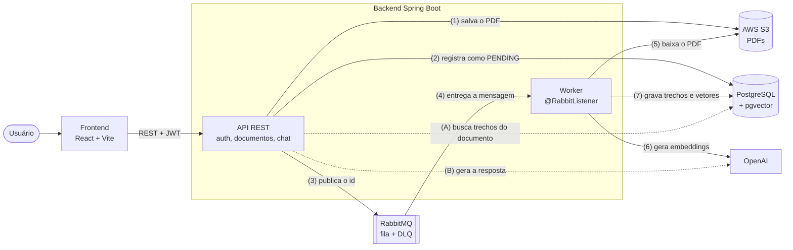

# Java Prev

Assistente de IA que lê regulamentos de previdência privada e responde perguntas sobre eles, indicando as páginas de onde tirou cada informação.

**Acesse:** [java-prev.igoralbuquerque.site](https://java-prev.igoralbuquerque.site)


## Por que este projeto existe

Trabalho como engenheiro de software e AI tech lead, com experiência principalmente em TypeScript, NestJS, mensageria e RAG. Para um processo seletivo de desenvolvedor Java no setor de previdência, eu queria mostrar, na prática, que essa base se transfere para o ecossistema Java.

Em vez de um CRUD de exemplo, escolhi um problema real do setor: regulamentos de previdência são longos, técnicos e difíceis de entender para quem contrata o plano. O Java Prev foi construído do zero em Java e Spring Boot ao longo de um fim de semana, com os mesmos padrões de arquitetura que uso no dia a dia.

## Como funciona

1. Você envia o PDF de um regulamento.
2. O arquivo vai para o S3 e o processamento entra numa fila. Um worker extrai o texto, divide em trechos e gera embeddings, que ficam no PostgreSQL com pgvector.
3. Você faz perguntas em linguagem natural. A API busca os trechos mais relevantes daquele documento, e o modelo responde usando apenas esse conteúdo. Se a informação não estiver no documento, a resposta diz isso.

O frontend também tem um Raio-X: para cada requisição, ele mostra o caminho percorrido pelas classes do backend, com o equivalente em NestJS de cada etapa.

## Arquitetura



As linhas contínuas mostram a ingestão de um documento, na ordem em que acontece. As tracejadas mostram uma pergunta no chat. O worker roda no mesmo processo da API e consome a fila de forma assíncrona; o frontend acompanha o status do documento até ele ficar pronto.

## Decisões de projeto

- **Upload fora da transação.** O PDF vai para o S3 antes de a transação no banco ser aberta, para não segurar uma conexão durante uma chamada de rede. Se a gravação no banco falhar, o arquivo é removido do S3.
- **Mensagem publicada só depois do commit.** Com `@TransactionalEventListener(AFTER_COMMIT)`, o worker nunca recebe o id de um documento que ainda não existe no banco.
- **Worker idempotente e DLQ.** A mesma mensagem pode chegar mais de uma vez, então o worker apaga os vetores anteriores antes de gravar. Erros inesperados vão para uma dead letter queue; erros permanentes, como um PDF sem texto, marcam o documento como falho sem reprocessar.
- **Isolamento por documento e por dono.** Além da checagem de posse no banco, a busca vetorial filtra por `document_id` e `owner_id`.
- **Autenticação com o suporte nativo do Spring Security.** Access token JWT de curta duração e refresh token opaco, guardado como hash, com rotação e detecção de reuso.
- **Prompt configurável.** O prompt de sistema fica num arquivo externo e é validado na inicialização: um prompt inválido impede a aplicação de subir.

## Stack

| Camada | Tecnologia |
|---|---|
| Backend | Java 21, Spring Boot 3.5, Spring Security, Spring Data JPA, Flyway |
| IA | Spring AI, OpenAI (`text-embedding-3-small` e `gpt-4o-mini`) |
| Dados | PostgreSQL 16 com pgvector |
| Mensageria | RabbitMQ com dead letter queue |
| Armazenamento | AWS S3 (SDK v2) |
| Frontend | React, Vite, TypeScript, TanStack Query |
| Infraestrutura | Docker Compose e Traefik |
| Testes | JUnit 5, Mockito e Testcontainers |

## De NestJS para Spring

| No NestJS | No Java Prev |
|---|---|
| `@Injectable()` e providers | `@Service` e injeção pelo construtor |
| DTO com `class-validator` | `record` com Bean Validation e `@Valid` |
| Guards e Passport | `SecurityFilterChain` e OAuth2 Resource Server |
| Exception filters | `@RestControllerAdvice` com `ProblemDetail` |
| Repository do TypeORM | `JpaRepository` com queries derivadas |
| Processor do BullMQ | `@RabbitListener` |

## Endpoints

| Método | Rota | Descrição |
|---|---|---|
| POST | `/api/v1/users` | Cadastro |
| POST | `/api/v1/auth/login` | Login (access token e refresh token) |
| POST | `/api/v1/auth/refresh` | Renova a sessão, rotacionando o refresh token |
| POST | `/api/v1/auth/logout` | Revoga o refresh token |
| GET | `/api/v1/users/me` | Usuário autenticado |
| POST | `/api/v1/documents` | Upload de PDF (responde `202 Accepted`) |
| GET | `/api/v1/documents` | Lista os documentos do usuário |
| GET | `/api/v1/documents/{id}` | Status de um documento |
| POST | `/api/v1/chat` | Pergunta sobre um documento |

## Rodando o projeto

Pré-requisitos: Docker, um bucket S3 com credenciais de acesso e uma chave da OpenAI.

```bash
cp .env.example .env                # domínio e senhas do Postgres e do RabbitMQ
cp server/.env.example server/.env  # OpenAI, JWT e AWS
docker compose up -d --build
```

Para rodar os testes do backend (o Docker precisa estar ativo, por causa do Testcontainers):

```bash
cd server
./mvnw verify
```

## Próximos passos

- Respostas em streaming via SSE
- Memória de conversa, reescrevendo a pergunta com o histórico antes da busca vetorial
- Outbox transacional para a publicação na fila
- OCR para PDFs digitalizados
- Deploy em ECS Fargate com RDS, Amazon MQ e task role do IAM para o S3

---

Feito por Igor Albuquerque.
