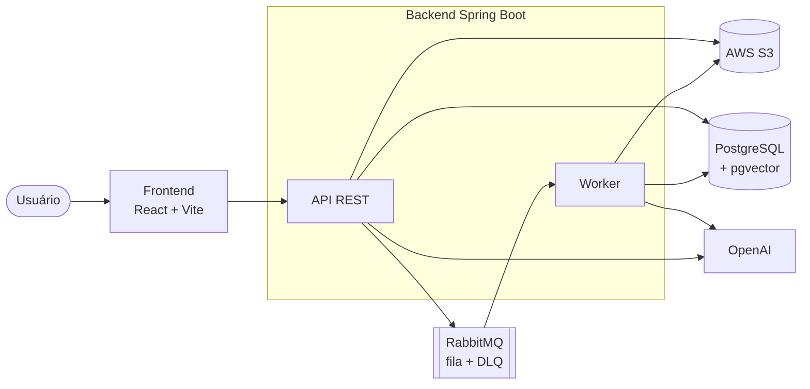
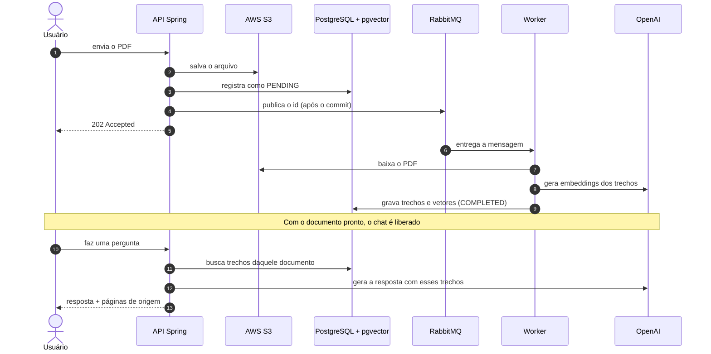

# Java Prev

Assistente de IA que lê regulamentos de previdência privada e responde perguntas sobre eles, indicando as páginas de onde tirou cada informação.

**Acesse:** [java-prev.igoralbuquerque.site](https://java-prev.igoralbuquerque.site)


## Por que este projeto existe

Trabalho como engenheiro de software e AI tech lead, com experiência principalmente em TypeScript, NestJS, mensageria e RAG. Para um processo seletivo de desenvolvedor Java no setor de previdência, eu queria mostrar, na prática, que essa base se transfere para o ecossistema Java.

Em vez de um CRUD de exemplo, escolhi um problema real do setor: regulamentos de previdência são longos, técnicos e difíceis de entender para quem contrata o plano. O Java Prev foi construído do zero em Java e Spring Boot ao longo de um fim de semana, com os mesmos padrões de arquitetura que uso no dia a dia, e está em produção no endereço acima.

## Como funciona

1. Você envia o PDF de um regulamento.
2. O arquivo vai para o S3 e o processamento entra numa fila. Um worker extrai o texto, divide em trechos e gera embeddings, que ficam no PostgreSQL com pgvector.
3. Você faz perguntas em linguagem natural. A API busca os trechos mais relevantes daquele documento, e o modelo responde usando apenas esse conteúdo. Se a informação não estiver no documento, a resposta diz isso.

## Frontend

O frontend em React serve a dois propósitos: ser o cliente do produto e mostrar como o backend funciona por dentro.

| Rota | O que tem |
|---|---|
| `/entrar` e `/cadastro` | Criação de conta e login |
| `/` | Upload de PDF, acompanhamento do processamento (`PENDING` → `PROCESSING` → `COMPLETED` ou `FAILED`) e chat com as páginas de origem |
| `/raio-x` | Para cada requisição, o caminho percorrido pelas classes do backend, com o equivalente em NestJS de cada etapa |
| `/por-dentro` | A infraestrutura explicada com diagramas: fila, DLQ, upload no S3, índices do pgvector e validação dos prompts |
| `/java` | Aulas comparativas de Java e Spring para quem vem do NestJS |

O frontend não importa nada do backend e conversa com a API apenas por HTTP, através de `VITE_API_URL`.

## Arquitetura



O worker roda no mesmo processo da API e consome a fila de forma assíncrona. O fluxo completo, do upload à resposta:



As linhas contínuas mostram a ingestão de um documento, na ordem em que acontece. As tracejadas mostram uma pergunta no chat. O frontend acompanha o status do documento até ele ficar pronto.

## Decisões de projeto

- **Upload fora da transação.** O PDF vai para o S3 antes de a transação no banco ser aberta, para não segurar uma conexão durante uma chamada de rede. Se a gravação no banco falhar, o arquivo é removido do S3.
- **Mensagem publicada só depois do commit.** Com `@TransactionalEventListener(AFTER_COMMIT)`, o worker nunca recebe o id de um documento que ainda não existe no banco.
- **Worker idempotente e DLQ.** A mesma mensagem pode chegar mais de uma vez, então o worker apaga os vetores anteriores antes de gravar. Erros inesperados vão para uma dead letter queue; erros permanentes, como um PDF sem texto, marcam o documento como falho sem reprocessar.
- **Isolamento por documento e por dono.** Além da checagem de posse no banco, a busca vetorial filtra por `document_id` e `owner_id`.
- **Autenticação com o suporte nativo do Spring Security.** Access token JWT de curta duração (15 min) e refresh token opaco (7 dias), guardado como hash, com rotação e detecção de reuso.
- **Prompt configurável.** O prompt de sistema fica num arquivo externo e é validado na inicialização: um prompt inválido impede a aplicação de subir.
- **Busca vetorial.** Índice HNSW com distância de cosseno sobre vetores de 1536 dimensões, trazendo os 5 trechos mais próximos acima de um limiar de similaridade de 0,3. Tamanho dos trechos, `top-k` e limiar ficam no `application.yml`.

Cada uma dessas decisões está explicada em detalhe, com o paralelo em NestJS, em [`server/docs/`](server/docs).

## Stack

| Camada | Tecnologia |
|---|---|
| Backend | Java 21, Spring Boot 3.5, Spring Security, Spring Data JPA, Flyway |
| IA | Spring AI, OpenAI (`text-embedding-3-small` e `gpt-4o-mini`) |
| Dados | PostgreSQL 16 com pgvector |
| Mensageria | RabbitMQ com dead letter queue |
| Armazenamento | AWS S3 (SDK v2) |
| Frontend | React 19, Vite, TypeScript, Tailwind CSS, TanStack Query, Zustand |
| Infraestrutura | Docker Compose e Traefik |
| Testes | JUnit 5, Mockito e Testcontainers no backend; Vitest e Testing Library no frontend |

## De NestJS para Spring

| No NestJS | No Java Prev |
|---|---|
| `@Injectable()` e providers | `@Service` e injeção pelo construtor |
| DTO com `class-validator` | `record` com Bean Validation e `@Valid` |
| Guards e Passport | `SecurityFilterChain` e OAuth2 Resource Server |
| Exception filters | `@RestControllerAdvice` com `ProblemDetail` |
| Repository do TypeORM | `JpaRepository` com queries derivadas |
| Processor do BullMQ | `@RabbitListener` |

## Estrutura do repositório

```
.
├── server/                  # API e worker (Spring Boot)
│   ├── src/main/java/br/com/igor/copilot/
│   │   ├── auth/            # JWT, refresh token com rotação
│   │   ├── user/            # cadastro e usuário autenticado
│   │   ├── document/        # upload, status, fila e ingestão (worker)
│   │   ├── chat/            # RAG, prompts e referências de página
│   │   ├── storage/         # integração com o S3
│   │   └── config/          # segurança, CORS, relógio
│   ├── src/main/resources/  # application.yml, migrations Flyway, prompts
│   ├── docs/                # explicações detalhadas de cada fase
│   ├── requests.http        # roteiro de chamadas prontas para a API
│   └── compose.yml          # só Postgres e RabbitMQ, para desenvolvimento
├── frontend/                # React + Vite
├── docker-compose.yml       # Postgres, RabbitMQ, API e frontend
└── .github/workflows/       # deploy
```

## Endpoints

| Método | Rota | Acesso | Descrição |
|---|---|---|---|
| POST | `/api/v1/users` | Público | Cadastro |
| POST | `/api/v1/auth/login` | Público | Login (access token e refresh token) |
| POST | `/api/v1/auth/refresh` | Público | Renova a sessão, rotacionando o refresh token |
| POST | `/api/v1/auth/logout` | Público | Revoga o refresh token |
| GET | `/api/v1/users/me` | JWT | Usuário autenticado |
| POST | `/api/v1/documents` | JWT | Upload de PDF (responde `202 Accepted`) |
| GET | `/api/v1/documents` | JWT | Lista os documentos do usuário |
| GET | `/api/v1/documents/{id}` | JWT | Status de um documento |
| POST | `/api/v1/chat` | JWT | Pergunta sobre um documento |

O arquivo [`server/requests.http`](server/requests.http) tem o roteiro completo, pronto para o HTTP Client do IntelliJ ou para a extensão REST Client do VS Code.

## Rodando o projeto

Pré-requisitos: Docker, um bucket S3 com credenciais de acesso e uma chave da OpenAI.

### Tudo com Docker Compose

```bash
cp server/.env.example server/.env   # preencha OpenAI, JWT, bucket e credenciais da AWS
docker compose up -d --build
```

| Serviço | Endereço |
|---|---|
| Frontend | http://localhost:5173 |
| API | http://localhost:8080 |
| Painel do RabbitMQ | http://localhost:15672 (usuário e senha `copilot`) |

As senhas do Postgres e do RabbitMQ e as portas têm valores padrão no `docker-compose.yml`. Para trocá-los, crie um `.env` na raiz com as mesmas variáveis (`POSTGRES_PASSWORD`, `RABBITMQ_DEFAULT_PASS`, `SERVER_PORT` e assim por diante).

### Desenvolvimento local

Sobe só a infraestrutura em Docker e roda a API e o frontend na sua máquina:

```bash
# Postgres com pgvector e RabbitMQ
cd server
docker compose up -d

# API (lê o server/.env)
cp .env.example .env
./mvnw spring-boot:run

# Frontend, em outro terminal
cd frontend
cp .env.example .env
npm install
npm run dev
```

### Variáveis de ambiente

**Backend** (`server/.env`):

| Variável | Obrigatória | Descrição |
|---|---|---|
| `OPENAI_API_KEY` | Sim | Chave da OpenAI |
| `JWT_SECRET` | Sim | Segredo do JWT, com no mínimo 32 caracteres (exigência do HS256) |
| `S3_BUCKET` | Sim | Nome do bucket |
| `AWS_REGION` | Não | Região do bucket (padrão `us-east-1`) |
| `S3_ENDPOINT` | Não | Endpoint alternativo, para serviços compatíveis com S3 |
| `APP_CORS_ALLOWED_ORIGINS` | Não | Origens liberadas no CORS, separadas por vírgula (padrão `http://localhost:5173`) |

**Credenciais da AWS.** Com Docker Compose, o `server/.env` vira variável de ambiente do container, então `AWS_ACCESS_KEY_ID` e `AWS_SECRET_ACCESS_KEY` podem ficar nele. Rodando com `./mvnw spring-boot:run`, não coloque as credenciais no `.env`: o Spring lê esse arquivo como propriedades, e o SDK da AWS não as enxerga. Use `aws configure`, que grava em `~/.aws/credentials`.

**Frontend** (`frontend/.env`):

| Variável | Obrigatória | Descrição |
|---|---|---|
| `VITE_API_URL` | Sim | Endereço da API (`http://localhost:8080`). Sem ela, o app mostra uma tela de erro de configuração |
| `VITE_RABBITMQ_UI_URL` | Não | Se preenchida, a página `/por-dentro` mostra um link para o painel do RabbitMQ |

## Testes

Backend (o Docker precisa estar ativo, por causa do Testcontainers):

```bash
cd server
./mvnw verify
```

Há testes unitários e testes de integração de ponta a ponta, que sobem PostgreSQL com pgvector e RabbitMQ reais em containers. S3 e OpenAI são trocados por fakes em memória (`InMemoryStorageService`, `FakeEmbeddingModel` e `FakeChatModel`), então a suíte é rápida, determinística e não gasta créditos da API.

Frontend:

```bash
cd frontend
npm test            # Vitest e Testing Library
npm run typecheck
npm run lint
```

## Deploy

O workflow [`deploy.yml`](.github/workflows/deploy.yml) roda a cada push na `main`: conecta por SSH na VPS, atualiza o código com `git pull` e sobe os containers com `docker compose -f docker-compose.prod.yml up -d --build`. O `docker-compose.prod.yml` fica fora do repositório (está no `.gitignore`), junto com os segredos de produção.

## Documentação complementar

- [`server/README.md`](server/README.md): visão do backend, com stack, decisões e roadmap.
- [`server/docs/`](server/docs): explicações detalhadas de autenticação, upload e worker, e chat com RAG, com paralelos em NestJS.
- [`frontend/README.md`](frontend/README.md): como o frontend está organizado e como rodá-lo.

## Próximos passos

- Respostas em streaming via SSE
- Memória de conversa, reescrevendo a pergunta com o histórico antes da busca vetorial
- Outbox transacional para a publicação na fila
- OCR para PDFs digitalizados
- Deploy em ECS Fargate com RDS, Amazon MQ e task role do IAM para o S3

---

Feito por Igor Albuquerque.
