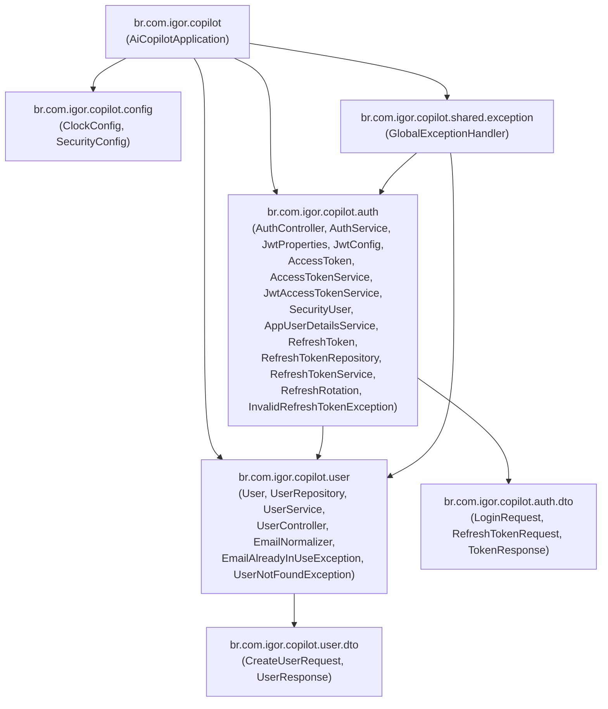
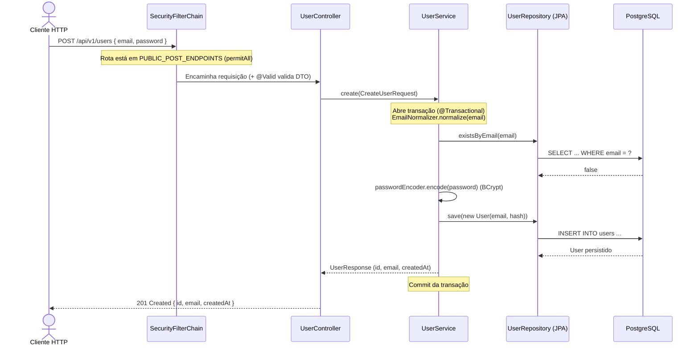
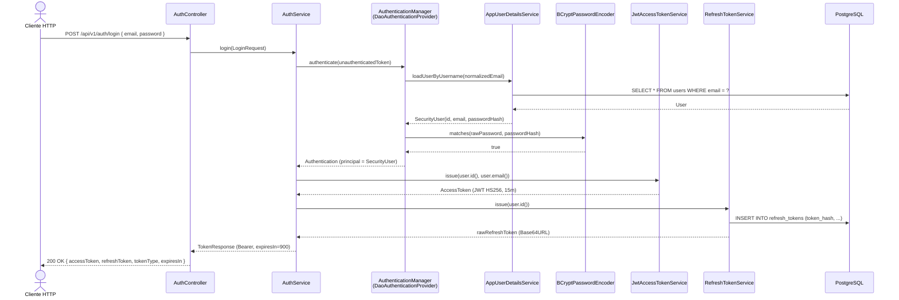
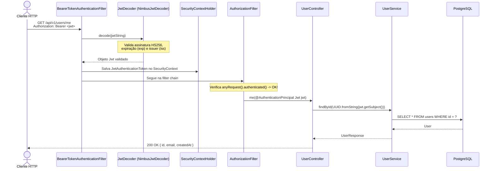
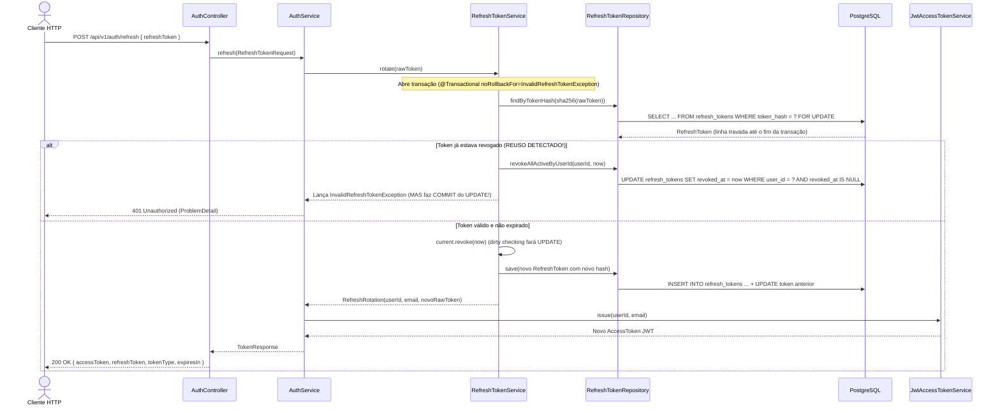
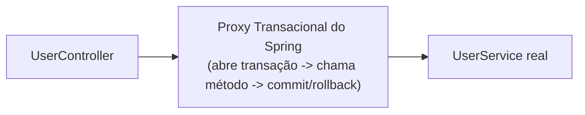

# Guia Didático — Fase 2: User & Auth (`ai-copilot`)

Este documento explica, linha a linha e conceito por conceito, a implementação da **Fase 2 (Usuários e Autenticação)** do projeto `ai-copilot`. Ele foi escrito especificamente para quem já domina **Node.js, TypeScript e NestJS** e está aprendendo **Java 21 e Spring Boot 3.5**, além de servir como material de preparação para entrevistas técnicas Java/Spring.

---

## 1. Visão geral da fase

### O que foi construído
Implementamos o módulo de cadastro e consulta de usuários (`user`) e o módulo completo de autenticação stateless (`auth`) com:
- **Cadastro de usuário (`POST /api/v1/users`)**: normalização de e-mail, validação de entrada (Jakarta Bean Validation) e hash de senha com **BCrypt**.
- **Login (`POST /api/v1/auth/login`)**: autenticação via `AuthenticationManager` do Spring Security, emissão de **Access Token JWT (HS256, 15 min)** pelo Spring OAuth2 Resource Server e emissão de **Refresh Token opaco (7 dias)** persistido no PostgreSQL apenas como hash **SHA-256**.
- **Consulta do usuário autenticado (`GET /api/v1/users/me`)**: extração automática do token Bearer e injeção do `Jwt` validado via `@AuthenticationPrincipal`.
- **Refresh com rotação e detecção de reuso (`POST /api/v1/auth/refresh`)**: lock pessimista (`SELECT ... FOR UPDATE`), revogação do token usado, emissão de novo par de tokens e revogação de todas as sessões ativas do usuário caso um token já revogado seja reutilizado.
- **Logout idempotente (`POST /api/v1/auth/logout`)**: revogação explícita do refresh token.
- **Tratamento global de erros (`GlobalExceptionHandler`)**: respostas padronizadas na **RFC 7807 (`ProblemDetail`)**.
- **Suíte de testes automatizados**: testes unitários rápidos com **JUnit 5 + Mockito** e testes de integração de ponta a ponta com **MockMvc + Testcontainers** (PostgreSQL + pgvector e RabbitMQ reais em containers Docker).

### Diagrama de pacotes (`package-by-feature`)

No Java, cada pasta dentro de `src/main/java` corresponde a um **pacote** (`package`), declarado na primeira linha de cada arquivo `.java`. Adotamos o estilo **package-by-feature** (equivalente aos diretórios de módulos do NestJS: `src/user/`, `src/auth/`, `src/shared/`), em vez de separar tudo em `controllers/`, `services/`, `repositories/`.



---

## 2. Mapa Nest → Spring desta fase

Se você conhece NestJS, você já conhece a arquitetura do Spring Boot — o NestJS foi diretamente inspirado no Spring e no Angular.

| Conceito no NestJS / Node.js | Equivalente no Spring Boot (nesta fase) | Como funciona no nosso código |
|---|---|---|
| `@Module({ imports, providers, controllers })` | `@SpringBootApplication` + pacotes Java (`package`) | O Spring faz *component scan* automático a partir do pacote raiz `br.com.igor.copilot`. Não existe arquivo `.module.ts`; basta anotar a classe com `@Service`, `@RestController` ou `@Configuration`. |
| `@Controller('api/v1/users')` | `@RestController` + `@RequestMapping("/api/v1/users")` | Usado em `UserController` e `AuthController`. O retorno dos métodos é serializado para JSON automaticamente pelo Jackson. |
| `@Injectable()` | `@Service` (ou `@Component`) | Marca classes de negócio (`UserService`, `AuthService`, `RefreshTokenService`, `JwtAccessTokenService`, `AppUserDetailsService`) para serem instanciadas e injetadas pelo container IoC do Spring. |
| Classe DTO + `class-validator` (`@IsEmail()`, `@MinLength(8)`) + `ValidationPipe` | `record` Java + Jakarta Bean Validation (`@Email`, `@NotBlank`, `@Size`) + `@Valid` | Usado em `CreateUserRequest`, `LoginRequest`, `RefreshTokenRequest`. O `@Valid` no parâmetro do controller dispara a validação antes do método rodar. |
| `AuthGuard('jwt')` (`@UseGuards`) | `SecurityFilterChain` (`SecurityConfig`) + `BearerTokenAuthenticationFilter` | Em vez de decorar rota por rota com `@UseGuards`, declaramos centralmente em `SecurityConfig` quais rotas são públicas (`permitAll()`) e que todas as demais exigem autenticação (`anyRequest().authenticated()`). |
| `@Catch()` (`ExceptionFilter`) | `@RestControllerAdvice` + `@ExceptionHandler` (`GlobalExceptionHandler`) | Intercepta exceções lançadas por qualquer controller ou service e devolve um `ProblemDetail` (RFC 7807). |
| `ConfigService` + `@nestjs/config` + Joi/Zod schema | `@ConfigurationProperties` + `@Validated` (`JwtProperties`) | Faz o bind automático do `application.yml` (`app.jwt.*`) para um objeto imutável fortemente tipado, validando na subida da aplicação (se `JWT_SECRET` tiver menos de 32 chars, a aplicação nem sobe). |
| `Repository<User>` do TypeORM / Prisma Client | `interface UserRepository extends JpaRepository<User, UUID>` | Você declara apenas a `interface`. O Spring Data JPA gera a classe concreta em tempo de execução, inferindo o SQL pelo nome do método (`findByEmail`, `existsByEmail`). |
| `@nestjs/jwt` (`JwtService.signAsync` / `verifyAsync`) | `JwtEncoder` (`NimbusJwtEncoder`) e `JwtDecoder` (`NimbusJwtDecoder`) | Beans configurados em `JwtConfig` usando a biblioteca oficial `spring-boot-starter-oauth2-resource-server`. |
| Passport (`LocalStrategy` + `JwtStrategy`) | `DaoAuthenticationProvider` + `UserDetailsService` (login) e `JwtAuthenticationProvider` (rotas autenticadas) | No login, `AuthenticationManager` usa `AppUserDetailsService` + `BCryptPasswordEncoder`. Nas rotas protegidas, o Resource Server valida o Bearer token via `JwtDecoder`. |

---

## 3. Conceitos de Java que apareceram

Abaixo estão todos os conceitos da linguagem Java utilizados nesta fase, sempre na estrutura: **o que é → por que existe → equivalente no Nest/Node → trecho de código comentado**.

---

### 3.1 `record`

- **O que é:** Um tipo especial de classe introduzido no Java 16 para representar **portadores de dados imutáveis** (*data carriers*). Ao declarar o cabeçalho de um `record`, o compilador Java gera automaticamente: campos `private final`, construtor completo (chamado *canonical constructor*), métodos de leitura (ex.: `email()`, sem o prefixo `get`) e implementações corretas de `equals()`, `hashCode()` e `toString()`.
- **Por que existe:** Antes do Java 16, criar um DTO de 3 campos exigia escrever 40 linhas de código (construtores, getters, `equals`, `hashCode`) ou usar bibliotecas de geração de bytecode como o Lombok (`@Value` / `@Data`). Com `record`, isso vira 4 linhas nativas da linguagem.
- **Equivalente no Nest/Node:** Uma `interface` ou `type` com propriedades `readonly` no TypeScript, combinada com uma classe de DTO validada pelo `class-validator`.
- **Trecho de código comentado** (`src/main/java/br/com/igor/copilot/user/dto/UserResponse.java`):

```java
// Declara um record público chamado UserResponse com 3 componentes imutáveis.
// O compilador gera automaticamente:
// - private final UUID id;
// - private final String email;
// - private final Instant createdAt;
// - construtor UserResponse(UUID id, String email, Instant createdAt)
// - métodos de acesso id(), email() e createdAt() (usados pelo Jackson para gerar o JSON)
public record UserResponse(
        UUID id,
        String email,
        Instant createdAt
) {
    // Records também podem ter métodos estáticos (factory methods) para conversão:
    public static UserResponse from(User user) {
        return new UserResponse(user.getId(), user.getEmail(), user.getCreatedAt());
    }
}
```

---

### 3.2 `Optional<T>`

- **O que é:** Um container que pode conter um valor não nulo do tipo `T` ou estar vazio (`Optional.empty()`).
- **Por que existe:** Para evitar o famoso `NullPointerException` (o equivalente ao `TypeError: Cannot read properties of undefined` do JavaScript) no retorno de métodos que podem não encontrar um resultado, obrigando quem chama a tratar explicitamente a ausência do valor com `.map(...)`, `.ifPresent(...)` ou `.orElseThrow(...)`.
- **Equivalente no Nest/Node:** Retornar `User | null` ou `User | undefined` no TypeScript com `strictNullChecks: true`.
- **Trecho de código comentado** (`src/main/java/br/com/igor/copilot/user/UserService.java`):

```java
@Transactional(readOnly = true)
public UserResponse findById(UUID id) {
    // findById(id) retorna Optional<User>, e não User diretamente.
    // Se houver um User dentro do Optional, orElseThrow devolve o User;
    // se estiver vazio, executa a função lambda e lança UserNotFoundException.
    User user = userRepository.findById(id)
            .orElseThrow(() -> new UserNotFoundException(id));
    return UserResponse.from(user);
}
```

---

### 3.3 `final`, `static` e `private`

- **O que são:** Modificadores de acesso e comportamento da linguagem Java:
  - `private`: o campo, método ou construtor só é visível dentro da própria classe.
  - `final`:
    - em uma **variável/campo**: a referência só pode ser atribuída **uma única vez** (no construtor ou na declaração);
    - em uma **classe** (`public final class EmailNormalizer`): a classe não pode ser herdada (`extends`).
  - `static`: pertence à **classe** em si, e não a uma instância (`new`) dela.
- **Por que existem:** Encapsulamento forte (impedir que código externo altere o estado interno de um objeto), imutabilidade das dependências injetadas (`private final`) e criação de constantes ou funções puras utilitárias (`static`).
- **Equivalente no Nest/Node:**
  - `private final` → `private readonly` no construtor do TypeScript;
  - `private static final` → uma constante `const` declarada no topo do módulo `.ts` fora da classe;
  - método `public static` → função utilitária exportada (`export function normalize(...)`) ou método `static` em classe TS.
- **Trecho de código comentado** (`src/main/java/br/com/igor/copilot/user/EmailNormalizer.java`):

```java
// 'final' na classe impede que alguém crie "class MeuNormalizer extends EmailNormalizer"
public final class EmailNormalizer {

    // Construtor 'private' impede que alguém faça "new EmailNormalizer()".
    // Como a classe só tem método estático, instanciá-la não faria sentido.
    private EmailNormalizer() {
    }

    // 'public static': chamado direto na classe via EmailNormalizer.normalize(email)
    public static String normalize(String email) {
        return email.trim().toLowerCase(Locale.ROOT);
    }
}
```

---

### 3.4 Construtores (inclusive o construtor `protected` do JPA)

- **O que é:** Um bloco especial que tem exatamente o mesmo nome da classe e **não tem tipo de retorno** (nem mesmo `void`). É executado quando fazemos `new NomeDaClasse(...)`. Uma classe Java pode ter **vários construtores** com listas de parâmetros diferentes (*sobrecarga de construtores* / *constructor overloading*).
- **Por que existe:** Para garantir que todo objeto já nasça em um estado válido e com suas dependências obrigatórias preenchidas. No caso das entidades JPA (`User` e `RefreshToken`), a especificação do Hibernate/JPA exige que exista um construtor sem argumentos (`no-arg constructor`) porque, quando o Hibernate faz um `SELECT` no banco, ele primeiro instancia o objeto vazio via reflexão (`Class.getDeclaredConstructor().newInstance()`) para depois preencher os campos com os valores das colunas. Nós o declaramos como `protected` (e não `public`) para que o Hibernate consiga usá-lo (e gerar proxies), mas nenhum código de negócio de outro pacote possa fazer `new User()` vazio acidentalmente.
- **Equivalente no Nest/Node:** `constructor(...)` no TypeScript (com a diferença de que o TypeScript só permite uma implementação de `constructor`, enquanto o Java permite múltiplos construtores sobrecarregados).
- **Trecho de código comentado** (`src/main/java/br/com/igor/copilot/user/User.java`):

```java
@Entity
@Table(name = "users")
public class User {
    // ... campos ...

    /**
     * Construtor sem argumentos exigido pelo JPA/Hibernate para hidratar entidades vindas do banco.
     * É 'protected' para impedir que nosso código faça 'new User()' sem passar email e senha.
     */
    protected User() {
    }

    // Construtor público usado pelo nosso código de negócio (UserService):
    // obriga a informar email e passwordHash na criação.
    public User(String email, String passwordHash) {
        this.email = email;
        this.password = passwordHash;
    }
}
```

---

### 3.5 Lambdas (`->`) e *Method References* (`::`)

- **O que são:**
  - **Lambda (`param -> expressao`):** função anônima passada como argumento. Em Java, usa-se seta simples `->` (em vez da *fat arrow* `=>` do JavaScript).
  - **Method Reference (`Classe::metodo`):** atalho sintático para uma lambda que apenas chama um método já existente no seu próprio argumento. Por exemplo, `AbstractHttpConfigurer::disable` é exatamente a mesma coisa que escrever `configurer -> configurer.disable()`. E `InvalidRefreshTokenException::new` equivale a `() -> new InvalidRefreshTokenException()`.
- **Por que existem:** Para permitir programação funcional concisa em coleções, `Optional` e DSLs de configuração como a do Spring Security.
- **Equivalente no Nest/Node:** Arrow functions `(s) => s.disable()` no JavaScript/TypeScript.
- **Trecho de código comentado** (`src/main/java/br/com/igor/copilot/config/SecurityConfig.java`):

```java
return http
        // Method reference: equivale a .csrf(c -> c.disable())
        .csrf(AbstractHttpConfigurer::disable)
        // Lambda explícita: recebe o configurador de sessão 's' e define a política STATELESS
        .sessionManagement(s -> s.sessionCreationPolicy(SessionCreationPolicy.STATELESS))
```

---

### 3.6 Generics (`JpaRepository<User, UUID>`)

- **O que é:** Parametrização de tipos entre sinais de menor e maior (`<T, ID>`), permitindo que uma classe ou interface opere de forma fortemente tipada sobre qualquer tipo informado.
- **Por que existe:** Para reaproveitar código (como métodos `save`, `findById`, `deleteById`) sem perder a checagem de tipos em tempo de compilação.
- **Equivalente no Nest/Node:** Generics do TypeScript (`Repository<User>`, `Promise<TokenResponse>`).
- **Trecho de código comentado** (`src/main/java/br/com/igor/copilot/user/UserRepository.java`):

```java
// Primeiro parâmetro genérico (User): qual é a entidade gerenciada.
// Segundo parâmetro genérico (UUID): qual é o tipo da chave primária (@Id) dessa entidade.
// Graças a isso, userRepository.findById(...) já sabe que recebe um UUID e retorna Optional<User>.
public interface UserRepository extends JpaRepository<User, UUID> {
    Optional<User> findByEmail(String email);
    boolean existsByEmail(String email);
}
```

---

### 3.7 Interfaces

- **O que é:** Um contrato que define assinaturas de métodos (entradas e saídas), sem estado. Uma classe assina esse contrato usando a palavra-chave `implements`.
- **Por que existe:** No Java, interfaces existem em tempo de execução (diferente do TypeScript, onde `interface` desaparece na transpilação para JS). No Spring, interfaces servem para dois propósitos principais:
  1. **Abstrair implementações substituíveis**: `AccessTokenService` define o contrato `issue(UUID, String)`, enquanto `JwtAccessTokenService` é a implementação concreta.
  2. **Geração dinâmica pelo framework**: em `UserRepository` e `RefreshTokenRepository`, nós escrevemos apenas a `interface` e o Spring Data cria a implementação em memória na subida da aplicação.
- **Equivalente no Nest/Node:** `interface` do TypeScript combinada com um *custom provider token* no NestJS (`{ provide: ACCESS_TOKEN_SERVICE, useClass: JwtAccessTokenService }`), porém no Spring não é preciso criar string/Symbol token: o próprio tipo da interface Java existe em runtime e é usado pelo container de injeção.
- **Trecho de código comentado** (`src/main/java/br/com/igor/copilot/auth/AccessTokenService.java` e `JwtAccessTokenService.java`):

```java
// Contrato: em interfaces Java, todos os métodos declarados já são implicitamente 'public abstract'
public interface AccessTokenService {
    AccessToken issue(UUID userId, String email);
}

// Implementação concreta registrada como bean no Spring (@Service)
@Service
public class JwtAccessTokenService implements AccessTokenService {
    @Override // Indica ao compilador que este método cumpre o contrato da interface
    public AccessToken issue(UUID userId, String email) {
        // ...
    }
}
```

---

### 3.8 Anotações (`@Annotation`) e Reflexão (*Reflection*)

- **O que são:** Metadados anexados a classes, métodos, campos ou parâmetros (`@Entity`, `@Service`, `@Transactional`, `@Valid`). Em conjunto com a **Reflexão** (capacidade da JVM de inspecionar classes, construtores, métodos e anotações em tempo de execução), elas dizem ao Spring e ao Hibernate como montar e executar o sistema.
- **Por que existem:** Para separar infraestrutura (transação de banco, rotas HTTP, validação, segurança, mapeamento objeto-relacional) da lógica de negócio limpa.
- **Equivalente no Nest/Node:** Decorators do TypeScript (`@Controller()`, `@Post()`, `@Injectable()`) baseados em `reflect-metadata`. A diferença é que, no Java, anotações são nativas da plataforma desde 2004 (Java 5) e os tipos dos parâmetros nunca são apagados no bytecode das assinaturas.
- **Trecho de código comentado** (`src/main/java/br/com/igor/copilot/user/UserController.java`):

```java
@RestController // Diz ao Spring MVC: registre esta classe como controller HTTP que retorna JSON
@RequestMapping("/api/v1/users") // Prefixo de rota
public class UserController {

    @PostMapping // Mapeia POST /api/v1/users
    @ResponseStatus(HttpStatus.CREATED) // Define status padrão 201
    // @RequestBody manda o Jackson ler o JSON do corpo; @Valid aciona o Bean Validation
    public UserResponse create(@RequestBody @Valid CreateUserRequest request) {
        return userService.create(request);
    }
}
```

---

### 3.9 Exceções *Checked* versus *Unchecked*

- **O que é:** O Java divide todas as exceções (`Exception`) em duas categorias:
  1. **Checked Exceptions** (as que herdam diretamente de `Exception`, como `NoSuchAlgorithmException`, `IOException`, `SQLException`): o compilador **obriga** você a capturá-las com `try / catch` ou declará-las na assinatura do método com `throws`. Se você não fizer isso, o código não compila.
  2. **Unchecked Exceptions** (as que herdam de `RuntimeException`, como `EmailAlreadyInUseException`, `InvalidRefreshTokenException`, `UserNotFoundException`): não exigem `try / catch` nem `throws` na assinatura. Além disso, por padrão, o `@Transactional` do Spring **faz rollback automático apenas em `RuntimeException`** (unchecked).
- **Por que existe:** Exceções *checked* foram criadas na origem do Java para forçar tratamento de falhas recuperáveis de infraestrutura; já no desenvolvimento moderno com Spring, todas as **exceções de negócio** estendem `RuntimeException` (*unchecked*) para não poluir as assinaturas dos services e controllers e para integrar com o rollback automático de transações e com o `@RestControllerAdvice`.
- **Equivalente no Nest/Node:** No JavaScript/TypeScript **toda** exceção é *unchecked* (qualquer função pode fazer `throw new ConflictException()` sem declarar nada na assinatura).
- **Trecho de código comentado** (`src/main/java/br/com/igor/copilot/auth/RefreshTokenService.java`):

```java
private String hash(String raw) {
    try {
        // MessageDigest.getInstance("SHA-256") declara "throws NoSuchAlgorithmException",
        // que é uma CHECKED exception. O compilador nos obriga a usar try/catch.
        MessageDigest digest = MessageDigest.getInstance("SHA-256");
        byte[] hashedBytes = digest.digest(raw.getBytes(StandardCharsets.UTF_8));
        return HexFormat.of().formatHex(hashedBytes);
    } catch (NoSuchAlgorithmException e) {
        // Como "SHA-256" é garantido por toda JVM padrão, embrulhamos em uma
        // IllegalStateException (que é UNCHECKED / RuntimeException).
        throw new IllegalStateException("Algoritmo SHA-256 indisponível na JVM", e);
    }
}
```

---

### 3.10 `throws Exception` nas assinaturas

- **O que é:** A cláusula `throws Exception` no cabeçalho de um método avisa ao compilador que aquele método pode deixar escapar uma exceção *checked* para quem o chamou.
- **Por que existe:** Em métodos de configuração do Spring Security (`securityFilterChain`, `authenticationManager`) e em métodos de teste do MockMvc (`mockMvc.perform(...)`), as APIs internas do framework declaram `throws Exception`. Em vez de colocar blocos `try / catch` inúteis dentro do método `@Bean` ou do `@Test`, declaramos `throws Exception` na assinatura e deixamos o próprio Spring Boot (na subida) ou o JUnit (no teste) capturar qualquer falha.
- **Equivalente no Nest/Node:** Não existe no TypeScript, pois o TS não verifica tipos de exceções lançadas nas assinaturas de funções.
- **Trecho de código comentado** (`src/main/java/br/com/igor/copilot/config/SecurityConfig.java`):

```java
@Bean
// http.build() e configuration.getAuthenticationManager() declaram 'throws Exception'.
// Repassamos 'throws Exception' na assinatura para o container do Spring tratar caso falhe na inicialização.
public SecurityFilterChain securityFilterChain(HttpSecurity http) throws Exception {
    // ...
}
```

---

## 4. Arquivo por arquivo, na ordem em que foram construídos

### 4.1 `pom.xml`
- **Papel:** Arquivo de manifesto do Maven (gerenciador de dependências e build).
- **Equivalente no Nest/Node:** `package.json`.
- **Pontos-chave:**
  - Removemos `io.jsonwebtoken:jjwt-*` e adicionamos `spring-boot-starter-oauth2-resource-server`, que traz o suporte oficial do Spring Security para emissão (`JwtEncoder`) e validação (`JwtDecoder`) de JWT via Nimbus JOSE + JWT.
  - Adicionamos `spring-boot-testcontainers`, `testcontainers:junit-jupiter`, `testcontainers:postgresql` e `testcontainers:rabbitmq` com `<scope>test</scope>` (equivalente a `devDependencies` no `package.json`).
  - Repare que não colocamos `<version>` nessas dependências: o `<parent>` (`spring-boot-starter-parent:3.5.15`) gerencia uma matriz de versões testadas e compatíveis entre si (chamada de *Bill of Materials* / BOM).

---

### 4.2 `src/main/resources/application.yml` e `.env.example`
- **Papel:** Arquivo central de configuração da aplicação e template de variáveis de ambiente.
- **Equivalente no Nest/Node:** `.env` + `ConfigModule.forRoot()`.
- **Trecho-chave explicado** (`src/main/resources/application.yml`):

```yaml
app:
  jwt:
    secret: ${JWT_SECRET}        # Lê a variável de ambiente JWT_SECRET (ou do arquivo .env)
    issuer: ai-copilot           # Identificador de quem emitiu o token (claim 'iss')
    access-token-ttl: 15m        # O Spring converte automaticamente "15m" para Duration.ofMinutes(15)
    refresh-token-ttl: 7d        # O Spring converte automaticamente "7d" para Duration.ofDays(7)
```

---

### 4.3 `src/main/java/br/com/igor/copilot/AiCopilotApplication.java`
- **Papel:** Ponto de entrada (`main`) que inicializa o Spring Boot.
- **Equivalente no Nest/Node:** `main.ts` (`NestFactory.create(AppModule)`).
- **Trecho-chave explicado:**

```java
@SpringBootApplication
// Faz o Spring procurar automaticamente records/classes anotados com @ConfigurationProperties
// (como a nossa JwtProperties) sem precisar registrá-los um a um.
@ConfigurationPropertiesScan
public class AiCopilotApplication {
    public static void main(String[] args) {
        SpringApplication.run(AiCopilotApplication.class, args);
    }
}
```

---

### 4.4 `src/main/java/br/com/igor/copilot/config/ClockConfig.java`
- **Papel:** Registra um relógio UTC (`java.time.Clock`) no container de injeção de dependência.
- **Equivalente no Nest/Node:** Um provider customizado para abstrair `Date.now()` e facilitar `jest.useFakeTimers()`.
- **Trecho-chave explicado:**

```java
@Configuration // Indica que esta classe fabrica beans para o container do Spring
public class ClockConfig {

    @Bean // O retorno deste método fica disponível para ser injetado em qualquer construtor que peça um Clock
    public Clock clock() {
        return Clock.systemUTC();
    }
}
```

---

### 4.5 `src/main/resources/db/migration/V2__create_refresh_tokens.sql`
- **Papel:** Migration SQL executada automaticamente pelo **Flyway** na subida da aplicação.
- **Equivalente no Nest/Node:** Migration do TypeORM ou Prisma Migrate.
- **Trecho-chave explicado:**

```sql
CREATE TABLE refresh_tokens (
    id          UUID PRIMARY KEY,
    -- Se o usuário for removido, seus refresh tokens são apagados em cascata pelo banco
    user_id     UUID        NOT NULL REFERENCES users(id) ON DELETE CASCADE,
    -- Guardamos o hash SHA-256 em hexadecimal (sempre 64 caracteres), nunca o token puro!
    token_hash  VARCHAR(64) NOT NULL UNIQUE,
    expires_at  TIMESTAMPTZ NOT NULL,
    -- Nulo enquanto o token está ativo; preenchido com a data/hora quando sofre rotação ou logout
    revoked_at  TIMESTAMPTZ,
    created_at  TIMESTAMPTZ NOT NULL DEFAULT now()
);

-- Índice essencial para o UPDATE em massa de revogação por user_id (detecção de reuso)
CREATE INDEX idx_refresh_tokens_user_id ON refresh_tokens(user_id);
```

---

### 4.6 Módulo `user`

#### `src/main/java/br/com/igor/copilot/user/EmailNormalizer.java`
- **Papel:** Padroniza qualquer e-mail que entra no sistema (no cadastro e no login) removendo espaços e convertendo para minúsculas.
- **Equivalente no Nest/Node:** Helper `normalizeEmail(email: string)` ou `.transform(v => v.trim().toLowerCase())` no Zod/class-transformer.

#### `src/main/java/br/com/igor/copilot/user/User.java`
- **Papel:** Entidade JPA mapeada para a tabela `users`.
- **Equivalente no Nest/Node:** `@Entity('users')` do TypeORM.
- **Trecho-chave explicado:**

```java
@Entity
@Table(name = "users")
public class User {

    @Id
    @GeneratedValue(strategy = GenerationType.UUID) // O Hibernate gera o UUID v4 na aplicação antes do INSERT
    private UUID id;

    @Column(nullable = false, unique = true)
    private String email;

    @Column(nullable = false)
    private String password; // Guarda exclusivamente o hash BCrypt

    @Column(name = "created_at", nullable = false, updatable = false)
    private Instant createdAt;

    protected User() {
    }

    public User(String email, String passwordHash) {
        this.email = email;
        this.password = passwordHash;
    }

    @PrePersist // Hook do ciclo de vida do JPA: roda automaticamente um instante antes do INSERT SQL
    void onCreate() {
        this.createdAt = Instant.now();
    }
    // ... apenas getters, sem setters públicos!
}
```

#### `src/main/java/br/com/igor/copilot/user/UserRepository.java`
- **Papel:** Interface de acesso a dados da entidade `User`.
- **Equivalente no Nest/Node:** `@InjectRepository(User)` do TypeORM.
- **Trecho-chave explicado:**

```java
public interface UserRepository extends JpaRepository<User, UUID> {
    // O Spring Data analisa o nome do método ("findBy" + "Email") e monta:
    // SELECT u FROM User u WHERE u.email = ?1
    Optional<User> findByEmail(String email);

    // Monta: SELECT COUNT(u) > 0 FROM User u WHERE u.email = ?1
    boolean existsByEmail(String email);
}
```

#### `src/main/java/br/com/igor/copilot/user/dto/CreateUserRequest.java` e `UserResponse.java`
- **Papel:** Contratos de entrada e saída da API de usuários.
- **Equivalente no Nest/Node:** `CreateUserDto` e `UserResponseDto`.
- **Trecho-chave explicado** (`CreateUserRequest.java`):

```java
public record CreateUserRequest(
        @NotBlank(message = "O e-mail é obrigatório")
        @Email(message = "O e-mail deve ser válido")
        String email,

        @NotBlank(message = "A senha é obrigatória")
        // Mínimo 8 caracteres; máximo 72 porque o BCrypt ignora qualquer byte após o 72º
        @Size(min = 8, max = 72, message = "A senha deve ter entre 8 e 72 caracteres")
        String password
) {
}
```

#### `src/main/java/br/com/igor/copilot/user/EmailAlreadyInUseException.java` e `UserNotFoundException.java`
- **Papel:** Exceções de domínio lançadas quando um e-mail já existe (409) ou quando um usuário não é encontrado (404).
- **Equivalente no Nest/Node:** `ConflictException` e `NotFoundException` (porém desacopladas do protocolo HTTP; quem decide o status HTTP é o `GlobalExceptionHandler`).

#### `src/main/java/br/com/igor/copilot/user/UserService.java`
- **Papel:** Regras de negócio para criação e busca de usuários.
- **Equivalente no Nest/Node:** `UsersService` (`@Injectable()`).
- **Trecho-chave explicado:**

```java
@Service
public class UserService {

    private final UserRepository userRepository;
    private final PasswordEncoder passwordEncoder;

    // Injeção de dependência via construtor (sem @Autowired!)
    public UserService(UserRepository userRepository, PasswordEncoder passwordEncoder) {
        this.userRepository = userRepository;
        this.passwordEncoder = passwordEncoder;
    }

    @Transactional // Abre transação de escrita; faz commit ao final ou rollback se lançar RuntimeException
    public UserResponse create(CreateUserRequest request) {
        String email = EmailNormalizer.normalize(request.email());
        if (userRepository.existsByEmail(email)) {
            throw new EmailAlreadyInUseException(email);
        }
        User user = new User(email, passwordEncoder.encode(request.password()));
        User saved = userRepository.save(user);
        return UserResponse.from(saved);
    }

    @Transactional(readOnly = true) // Otimização para leitura (desliga dirty checking no Hibernate)
    public UserResponse findById(UUID id) {
        User user = userRepository.findById(id)
                .orElseThrow(() -> new UserNotFoundException(id));
        return UserResponse.from(user);
    }
}
```

#### `src/main/java/br/com/igor/copilot/user/UserController.java`
- **Papel:** Exposição HTTP dos endpoints `POST /api/v1/users` e `GET /api/v1/users/me`.
- **Equivalente no Nest/Node:** `UsersController`.
- **Trecho-chave explicado:**

```java
@GetMapping("/me")
// @AuthenticationPrincipal extrai o objeto principal guardado no SecurityContext pelo filtro de JWT.
// jwt.getSubject() lê a claim "sub" do token, onde gravamos o UUID do usuário no momento do login.
public UserResponse me(@AuthenticationPrincipal Jwt jwt) {
    return userService.findById(UUID.fromString(jwt.getSubject()));
}
```

---

### 4.7 Módulo `auth`

#### `src/main/java/br/com/igor/copilot/auth/JwtProperties.java`
- **Papel:** Objeto imutável de configuração que mapeia `app.jwt.*` do `application.yml`.
- **Equivalente no Nest/Node:** `registerAs('jwt', () => ({ ... }))` do `@nestjs/config`.

#### `src/main/java/br/com/igor/copilot/auth/JwtConfig.java`
- **Papel:** Cria os beans `SecretKey`, `JwtEncoder` e `JwtDecoder` para assinar e verificar tokens JWT com HMAC-SHA256 (`HS256`).
- **Equivalente no Nest/Node:** `JwtModule.registerAsync({ ... })`.
- **Trecho-chave explicado:**

```java
@Bean
public JwtDecoder jwtDecoder(SecretKey jwtSecretKey, JwtProperties props) {
    // Constrói o validador criptográfico usando a chave simétrica e algoritmo HS256
    NimbusJwtDecoder decoder = NimbusJwtDecoder.withSecretKey(jwtSecretKey)
            .macAlgorithm(MacAlgorithm.HS256)
            .build();
    // Além de validar assinatura e expiração (exp), exige que a claim 'iss' seja "ai-copilot"
    decoder.setJwtValidator(JwtValidators.createDefaultWithIssuer(props.issuer()));
    return decoder;
}
```

#### `AccessToken.java`, `AccessTokenService.java` e `JwtAccessTokenService.java`
- **Papel:** Emissão de tokens de acesso JWT curtos (15 minutos).
- **Equivalente no Nest/Node:** `jwtService.sign({ sub: userId, email })`.
- **Trecho-chave explicado** (`JwtAccessTokenService.java`):

```java
Instant now = clock.instant();
Instant expiresAt = now.plus(props.accessTokenTtl());
JwtClaimsSet claims = JwtClaimsSet.builder()
        .issuer(props.issuer())          // Claim 'iss': "ai-copilot"
        .subject(userId.toString())      // Claim 'sub': UUID do usuário em String
        .issuedAt(now)                   // Claim 'iat'
        .expiresAt(expiresAt)            // Claim 'exp' (iat + 15m)
        .claim("email", email)           // Claim customizada 'email'
        .build();
JwsHeader header = JwsHeader.with(MacAlgorithm.HS256).build();
String value = jwtEncoder.encode(JwtEncoderParameters.from(header, claims)).getTokenValue();
return new AccessToken(value, expiresAt);
```

#### `SecurityUser.java` e `AppUserDetailsService.java`
- **Papel:** Ponte entre a nossa entidade `User` do banco e o contrato `UserDetails` / `UserDetailsService` que o motor de autenticação do Spring Security entende.
- **Equivalente no Nest/Node:** `LocalStrategy.validate(email, password)` do `@nestjs/passport`.
- **Por que `Using generated security password` sumiu do log?** Quando o `spring-boot-starter-security` está no projeto e não encontra nenhum bean `UserDetailsService`, ele cria um usuário padrão `user` em memória e imprime uma senha aleatória no console. Ao registrarmos `AppUserDetailsService` (`@Service implements UserDetailsService`), a autoconfiguração percebe que agora temos nosso próprio carregador de usuários e desliga o usuário em memória.

#### `RefreshToken.java` e `RefreshTokenRepository.java`
- **Papel:** Entidade JPA e repositório da tabela `refresh_tokens`.
- **Trecho-chave explicado** (`RefreshTokenRepository.java`):

```java
// PESSIMISTIC_WRITE faz o PostgreSQL executar:
// SELECT ... FROM refresh_tokens WHERE token_hash = ? FOR UPDATE
// Se duas requisições tentarem usar o mesmo refresh token no mesmo milissegundo,
// o banco trava a linha para a primeira transação e faz a segunda esperar na fila.
@Lock(LockModeType.PESSIMISTIC_WRITE)
Optional<RefreshToken> findByTokenHash(String tokenHash);

// @Modifying indica ao Spring Data que a query @Query não é um SELECT, e sim um UPDATE.
// Revoga de uma só vez todos os tokens ativos daquele usuário quando detectamos reuso.
@Modifying
@Query("update RefreshToken r set r.revokedAt = :now where r.user.id = :userId and r.revokedAt is null")
int revokeAllActiveByUserId(@Param("userId") UUID userId, @Param("now") Instant now);
```

#### `RefreshRotation.java`, `InvalidRefreshTokenException.java` e `RefreshTokenService.java`
- **Papel:** Ciclo de vida completo do refresh token (geração de 32 bytes aleatórios criptográficos, hashing SHA-256, rotação com detecção de reuso e revogação).
- **Trecho-chave explicado** (`RefreshTokenService.java`):

```java
@Transactional(noRollbackFor = InvalidRefreshTokenException.class)
public RefreshRotation rotate(String rawToken) {
    Instant now = clock.instant();
    // 1. Calcula o SHA-256 do token recebido e busca no banco com lock FOR UPDATE
    RefreshToken current = refreshTokenRepository.findByTokenHash(hash(rawToken))
            .orElseThrow(InvalidRefreshTokenException::new);

    User user = current.getUser();
    UUID userId = user.getId();

    // 2. Se o token já estava revogado, alguém está reutilizando um token antigo!
    // Revogamos TODAS as sessões ativas do usuário por segurança e lançamos 401.
    if (current.isRevoked()) {
        refreshTokenRepository.revokeAllActiveByUserId(userId, now);
        log.warn("Reuso de refresh token detectado; sessões revogadas para o usuário {}", userId);
        throw new InvalidRefreshTokenException();
    }

    // 3. Se expirou, rejeita
    if (current.isExpired(now)) {
        throw new InvalidRefreshTokenException();
    }

    // 4. Revoga o token atual e emite um novo token na mesma transação
    current.revoke(now);
    String newToken = persistNew(user, now);
    // 5. Lê user.getEmail() ainda dentro da transação aberta para evitar LazyInitializationException
    return new RefreshRotation(userId, user.getEmail(), newToken);
}
```

#### `LoginRequest.java`, `RefreshTokenRequest.java`, `TokenResponse.java`, `AuthService.java` e `AuthController.java`
- **Papel:** DTOs, orquestração de login/refresh/logout e exposição dos endpoints `/api/v1/auth/*`.
- **Trecho-chave explicado** (`AuthService.java`):

```java
public TokenResponse login(LoginRequest request) {
    // Entrega e-mail normalizado e senha pura para o AuthenticationManager.
    // Internamente, o DaoAuthenticationProvider chama AppUserDetailsService.loadUserByUsername(...)
    // e compara a senha com BCryptPasswordEncoder.matches(...). Se falhar, lança BadCredentialsException.
    Authentication authentication = authenticationManager.authenticate(
            UsernamePasswordAuthenticationToken.unauthenticated(
                    EmailNormalizer.normalize(request.email()),
                    request.password()
            )
    );
    SecurityUser user = (SecurityUser) authentication.getPrincipal();
    AccessToken access = accessTokenService.issue(user.id(), user.email());
    String refresh = refreshTokenService.issue(user.id());
    return TokenResponse.bearer(access.value(), refresh, props.accessTokenTtl().toSeconds());
}
```

---

### 4.8 `src/main/java/br/com/igor/copilot/config/SecurityConfig.java`
- **Papel:** Configuração central de segurança HTTP (`SecurityFilterChain`), `PasswordEncoder` (BCrypt) e exposição do `AuthenticationManager`.
- **Equivalente no Nest/Node:** Configuração global de Guards + registro do Passport/JwtModule.

---

### 4.9 `src/main/java/br/com/igor/copilot/shared/exception/GlobalExceptionHandler.java`
- **Papel:** Traduz exceções de validação, autenticação, banco de dados e negócio para respostas HTTP padronizadas no formato **Problem Details for HTTP APIs (RFC 7807)**.
- **Equivalente no Nest/Node:** `AllExceptionsFilter` global (`app.useGlobalFilters(...)`).

---

## 5. Como uma requisição atravessa o Spring

No Spring Boot, toda requisição HTTP passa primeiro por uma **cadeia de filtros Servlet** (`SecurityFilterChain`) antes de chegar ao `DispatcherServlet` e ao seu `@RestController`.

### (a) Cadastro (`POST /api/v1/users`)



### (b) Login (`POST /api/v1/auth/login`)



### (c) Requisição autenticada (`GET /api/v1/users/me`)



### (d) Refresh com rotação (`POST /api/v1/auth/refresh`)




---

## 6. Segurança em detalhe

### 6.1 Por que usar o OAuth2 Resource Server e não um filtro manual com `jjwt`?
- **O que é:** O `spring-boot-starter-oauth2-resource-server` é o módulo oficial do Spring Security para validação e emissão de tokens JWT (baseado na biblioteca certificada **Nimbus JOSE + JWT**).
- **Por que existe:** Em tutoriais antigos na internet, é comum ver desenvolvedores adicionando `io.jsonwebtoken:jjwt` e escrevendo uma classe manual `JwtAuthenticationFilter extends OncePerRequestFilter`. Isso traz três problemas:
  1. Você passa a manter código próprio de segurança (extração do header `Authorization`, tratamento de `ExpiredJwtException`, população manual do `SecurityContextHolder`, tratamento de `AuthenticationEntryPoint`).
  2. Você adiciona uma dependência externa (`jjwt`) que não faz parte do gerenciamento oficial de versões do Spring Boot.
  3. O Resource Server já entrega o `BearerTokenAuthenticationFilter` testado em batalha, integrado nativamente com `@AuthenticationPrincipal Jwt jwt` e com os códigos de erro HTTP 401/403 padronizados pela RFC 6750.
- **Equivalente no Nest/Node:** Usar a estratégia oficial `@nestjs/passport` + `passport-jwt` em vez de escrever um middleware Express manual que faz `req.headers.authorization.split(' ')`.

---

### 6.2 HS256 versus RS256
- **O que é:**
  - **HS256 (HMAC com SHA-256):** algoritmo **simétrico**. A mesma chave secreta (`JWT_SECRET`, de no mínimo 256 bits / 32 caracteres) é usada para assinar e para verificar o token.
  - **RS256 (RSA Signature com SHA-256):** algoritmo **assimétrico**. Uma chave **privada** assina o token e uma chave **pública** (que pode ser distribuída via endpoint JWKS) verifica a assinatura.
- **Por que escolhemos HS256 aqui:** Na nossa arquitetura atual, o `ai-copilot` é um monolito modular: a mesma aplicação que emite o token no `/api/v1/auth/login` é a única que valida o token nas rotas `/api/v1/**`. Logo, HS256 é mais simples, rápido e não exige gerenciamento de arquivos PEM/chaves RSA. Se no futuro dividirmos o sistema em múltiplos microsserviços onde apenas o `auth-service` deve poder emitir tokens e outros 10 serviços apenas validam, migraríamos para **RS256** (trocando apenas o bean em `JwtConfig`, sem tocar em uma linha de `AuthService` ou `UserController`).

---

### 6.3 Access Token curto (15 min) versus Refresh Token longo (7 dias)
- **O que é:** Separação entre o token de autorização rápida (Access Token JWT, stateless, 15 minutos) e o token de renovação de sessão (Refresh Token opaco, stateful no banco, 7 dias).
- **Por que existe:** Um JWT puro é **stateless**: depois de emitido, ele é válido até o timestamp `exp` sem consultar o banco de dados. Se emitíssemos um JWT com validade de 7 dias e ele fosse roubado (ou o usuário clicasse em "Sair"), não haveria como invalidá-lo sem criar uma *blocklist* consultada a cada requisição (o que destruiria a vantagem de ser stateless). Com um Access Token de **15 minutos** e um Refresh Token de **7 dias** persistido no banco:
  - 99% das requisições de API (`GET /api/v1/users/me`, chat, documentos) validam apenas a assinatura do JWT em memória, com **zero queries ao banco**;
  - a consulta ao banco na tabela `refresh_tokens` acontece **apenas uma vez a cada 15 minutos** (no `/api/v1/auth/refresh`), momento em que verificamos se a sessão foi revogada.

---

### 6.4 Por que o Refresh Token é opaco e guardado como hash SHA-256 (e por que SHA-256 basta aqui, enquanto senha exige BCrypt)?
- **O que é:** O refresh token não é um JWT; ele é uma sequência de **32 bytes (256 bits) puramente aleatórios** gerados por `SecureRandom` e codificados em Base64URL. No banco (`refresh_tokens.token_hash`), salvamos apenas o **hash SHA-256** dele (64 caracteres hexadecimais).
- **Por que existe:** Se um atacante conseguir acesso de leitura ao banco de dados (ex.: vazamento de backup SQL ou SQL Injection), ele **não conseguirá usar os refresh tokens** das vítimas, pois o hash SHA-256 é unidirecional e a API exige o token bruto original.
- **Por que SHA-256 basta para o Refresh Token, mas Senha exige BCrypt?**
  - **Senhas humanas têm baixa entropia:** usuários escolhem senhas previsíveis ou curtas. Como o SHA-256 é extremamente rápido (uma GPU moderna calcula bilhões de hashes SHA-256 por segundo), um atacante quebraria senhas com SHA-256 em segundos via força bruta/*rainbow tables*. Por isso, para senhas usamos **BCrypt**, que é propositalmente **lento** (custo exponencial configurável) e inclui **salt aleatório** embutido.
  - **Refresh tokens têm 256 bits de entropia criptográfica (`SecureRandom`):** tentar adivinhar um número aleatório de 256 bits por força bruta exigiria $2^{256}$ tentativas (mais átomos do que existem no universo observável). Não há dicionário possível. Além disso, precisamos buscar o token no banco por índice (`WHERE token_hash = ?`), o que exige um hash determinístico (sem salt aleatório por linha) como o **SHA-256**.

---

### 6.5 Rotação de Refresh Token e Detecção de Reuso
- **O que é:** Cada refresh token só pode ser usado **uma única vez**. Ao chamar `POST /api/v1/auth/refresh`:
  1. O token enviado recebe `revoked_at = now`.
  2. Um novo refresh token é salvo e devolvido ao cliente.
  3. Se alguém tentar usar um refresh token que **já possui `revoked_at` preenchido**, sabemos com certeza que houve **reuso** (ou um atacante roubou o token e o usou antes do usuário legítimo, ou o usuário legítimo já rotacionou e o atacante está tentando usar o token antigo vazado).
- **O que fazemos ao detectar reuso:** Chamamos `refreshTokenRepository.revokeAllActiveByUserId(userId, now)`, invalidando imediatamente **todas** as sessões daquele usuário, registramos um `log.warn` de auditoria e retornamos `401 Unauthorized`. O usuário legítimo precisará fazer login novamente com e-mail e senha, e o atacante fica totalmente bloqueado.

---

### 6.6 O Lock Pessimista (`@Lock(LockModeType.PESSIMISTIC_WRITE)`)
- **O que é:** Anotação no `RefreshTokenRepository.findByTokenHash` que instrui o Hibernate a emitir `SELECT ... FROM refresh_tokens WHERE token_hash = ? FOR UPDATE`.
- **Por que existe:** Imagine que o frontend do usuário dispare duas chamadas simultâneas de `/api/v1/auth/refresh` com o mesmo token (por exemplo, duas abas ou duas chamadas `fetch` concorrentes quando o access token expira). Sem lock no banco:
  - A Requisição A e a Requisição B leriam `revoked_at = null` ao mesmo tempo e ambas emitiriam tokens novos (violando a regra de uso único), ou causariam um falso-positivo de reuso inconsistente.
  - Com `PESSIMISTIC_WRITE` (`FOR UPDATE`), o PostgreSQL trava a linha para a Requisição A. A Requisição B fica bloqueada no `SELECT` esperando o commit da Requisição A; quando A faz commit (gravando `revoked_at`), B lê a linha atualizada e enxerga que o token já foi revogado.

---

### 6.7 Mensagem idêntica para e-mail inexistente e senha errada
- **O que é:** Tanto um login com e-mail não cadastrado quanto um login com senha incorreta retornam exatamente `401 Unauthorized` com `{"detail": "Credenciais inválidas"}`.
- **Por que existe:** Prevenção contra **enumeração de usuários** (*User Enumeration*). Se a API respondesse `"E-mail não encontrado"` num caso e `"Senha incorreta"` no outro, um atacante poderia testar uma lista de milhões de e-mails para descobrir quais clientes possuem conta no sistema. O `DaoAuthenticationProvider` do Spring Security já esconde a `UsernameNotFoundException` lançada pelo `AppUserDetailsService`, convertendo-a internamente em `BadCredentialsException`, que o nosso `GlobalExceptionHandler` captura como `AuthenticationException` e transforma em `"Credenciais inválidas"`.

---

### 6.8 Limite de 72 bytes do BCrypt
- **O que é:** A anotação `@Size(min = 8, max = 72)` no campo `password` do `CreateUserRequest`.
- **Por que existe:** O algoritmo BCrypt, por design matemático, processa apenas os primeiros **72 bytes** da senha e descarta silenciosamente qualquer caractere a partir do 73º. Se não limitássemos em 72 caracteres na validação, um usuário que cadastrasse uma senha de 100 caracteres acharia que todos os 100 caracteres estão protegendo a conta, quando na verdade digitar apenas os primeiros 72 caracteres no login funcionaria normalmente (além de evitar ataques de negação de serviço onde alguém envia 1 MB de texto no campo `password` para travar a CPU no hashing).

---

### 6.9 Refresh Token no corpo JSON versus Cookie `HttpOnly` (Trade-offs)
- **Como fizemos:** Retornamos e recebemos o `refreshToken` no corpo JSON (`TokenResponse` e `RefreshTokenRequest`).
- **Trade-offs importantes para entrevistas:**

| Abordagem | Vantagens | Desvantagens / Cuidados |
|---|---|---|
| **No corpo JSON** (nosso código) | Funciona de forma uniforme para SPAs web, aplicativos Mobile (iOS/Android Secure Storage) e CLIs; não exige configuração de CORS com `credentials: true` nem proteção CSRF em rotas de cookie. | Se o cliente for um navegador Web e guardar o token no `localStorage`, ele fica vulnerável a roubo via XSS (Cross-Site Scripting). Mitigamos o impacto com a **rotação + detecção de reuso**. |
| **Em Cookie `HttpOnly; Secure; SameSite=Strict`** | O JavaScript do navegador não consegue ler o cookie via `document.cookie`, protegendo o refresh token contra XSS. | Mais complexo para clientes mobile/nativos; exige atenção a CSRF (mitigado por `SameSite=Strict` ou Path restrito a `/api/v1/auth`). |

---

## 7. Transações e JPA

### 7.1 `@Transactional` e como o Proxy do Spring funciona
- **O que é:** Anotação declarativa que abre uma transação no banco de dados antes do método iniciar, faz `COMMIT` quando o método termina normalmente e faz `ROLLBACK` automático caso uma `RuntimeException` escape do método.
- **Como funciona por baixo dos panos (Proxy):** Quando você injeta `UserService` no `UserController`, o Spring **não** entrega uma instância direta de `UserService`. Ele cria dinamicamente uma subclasse em memória (um **Proxy CGLIB**) que envolve o seu `UserService`:



- **Equivalente no Nest/Node:** Em vez de escrever `await dataSource.transaction(async (manager) => { ... })` manualmente em todo método como no TypeORM, o proxy do Spring faz isso de forma transparente.
- **Regra de ouro para entrevistas:** Como o `@Transactional` funciona via **Proxy**, chamadas internas dentro da mesma classe (`this.outroMetodoTransacional()`) **não passam pelo proxy** e ignoram a anotação. Por isso, métodos `@Transactional` devem ser sempre `public` e chamados por outra classe (ex.: `Controller -> Service`, ou `AuthService -> RefreshTokenService`).

---

### 7.2 `@Transactional(readOnly = true)`
- **O que é:** Usado em `UserService.findById(UUID id)`.
- **Por que existe:** Sinaliza ao Spring, ao Hibernate e ao driver JDBC do PostgreSQL que aquela transação apenas lerá dados. O Hibernate **desativa o *dirty checking*** (não precisa tirar uma cópia em memória dos objetos lidos para comparar no final), reduzindo consumo de memória e CPU.

---

### 7.3 Dirty Checking (Detecção automática de mudanças)
- **O que é:** Enquanto uma transação de escrita (`@Transactional`) está aberta, toda entidade buscada pelo repositório é uma **entidade gerenciada** (*managed entity*). O Hibernate guarda um *snapshot* do estado inicial dela. Antes do commit, ele compara os campos atuais com o *snapshot*: se algum campo mudou, ele gera e executa o `UPDATE` SQL automaticamente — **sem que você precise chamar `repository.save(...)`!**
- **Trecho de código comentado** (`src/main/java/br/com/igor/copilot/auth/RefreshTokenService.java`):

```java
@Transactional
public void revoke(String rawToken) {
    Instant now = clock.instant();
    refreshTokenRepository.findByTokenHash(hash(rawToken))
            .ifPresent(token -> {
                if (!token.isRevoked()) {
                    // Apenas alteramos o campo revokedAt do objeto em memória!
                    // Não chamamos refreshTokenRepository.save(token).
                    // No commit da transação, o Dirty Checking do Hibernate detecta a mudança
                    // e dispara: UPDATE refresh_tokens SET revoked_at = ? WHERE id = ?
                    token.revoke(now);
                }
            });
}
```

---

### 7.4 `getReferenceById` versus `findById`
- **O que é:** Em `RefreshTokenService.issue(UUID userId)`, usamos `User user = userRepository.getReferenceById(userId)` em vez de `findById(userId)`.
- **Por que existe:** Para salvar um `RefreshToken`, o banco de dados só precisa do valor da chave estrangeira `user_id` (que nós já temos em mãos no `UUID userId`). Se usássemos `findById(userId)`, o Hibernate faria um `SELECT * FROM users WHERE id = ?` desnecessário antes do `INSERT INTO refresh_tokens`. O `getReferenceById(userId)` retorna um **proxy leve** contendo apenas o `id`, sem ir ao banco de dados, permitindo preencher o relacionamento `@ManyToOne` e executar apenas o `INSERT`.

---

### 7.5 `FetchType.LAZY` combinado com `spring.jpa.open-in-view: false`
- **O que é:**
  - Na entidade `RefreshToken`, mapeamos `@ManyToOne(fetch = FetchType.LAZY) private User user;`. Isso significa que, ao buscar um `RefreshToken`, o Hibernate **não** faz `JOIN` automático com a tabela `users`; ele só busca os dados de `User` se e quando chamarmos `user.getEmail()`.
  - No `application.yml`, configuramos `spring.jpa.open-in-view: false`, o que fecha a sessão do banco imediatamente ao fim do método `@Transactional` do Service (em vez de mantê-la aberta até a renderização do JSON no Controller).
- **Por que existe:** Manter a conexão de banco aberta durante a camada HTTP (*Open Session in View*, que vem `true` por padrão no Spring Boot) é um famoso anti-padrão de performance porque prende conexões do pool e esconde problemas de N+1 queries.
- **Como evitamos `LazyInitializationException` no nosso código:** Em `RefreshTokenService.rotate`, lemos `user.getEmail()` **dentro** do método `@Transactional` e já o empacotamos no record `RefreshRotation(userId, user.getEmail(), newToken)` antes de a transação fechar.

---

### 7.6 A pegadinha do `noRollbackFor` e por que o `AuthService` NÃO é `@Transactional`
Este é um dos pontos mais importantes do projeto e uma excelente história para contar em entrevistas técnicas:

1. **O problema do rollback padrão:** Quando `RefreshTokenService.rotate` detecta que um token revogado foi reutilizado, ele executa:
   ```java
   refreshTokenRepository.revokeAllActiveByUserId(userId, now);
   throw new InvalidRefreshTokenException();
   ```
   Como `InvalidRefreshTokenException` é uma `RuntimeException`, o comportamento padrão do `@Transactional` seria fazer **ROLLBACK** da transação — o que **desfaria o `UPDATE` que acabou de revogar as sessões do usuário!**
2. **A primeira metade da solução (`noRollbackFor`):** Anotamos o método `rotate` com:
   ```java
   @Transactional(noRollbackFor = InvalidRefreshTokenException.class)
   ```
   Isso diz ao Spring: *"mesmo que `InvalidRefreshTokenException` seja lançada, faça **COMMIT** das alterações feitas até aqui (mantendo a revogação em massa salva no banco) e depois propague a exceção para o controller retornar 401"*.
3. **Por que `AuthService` NÃO pode ter `@Transactional`:** Se `AuthService.refresh` também tivesse `@Transactional`, o método `RefreshTokenService.rotate` participaria da **mesma transação física** iniciada pelo `AuthService` (propagação padrão `REQUIRED`). Quando a `InvalidRefreshTokenException` saísse de `rotate` e passasse pelo proxy de `AuthService` (que não tem `noRollbackFor`), o `AuthService` marcaria a transação inteira para rollback, anulando o `noRollbackFor` interno! Mantendo `AuthService` sem `@Transactional`, a transação começa e faz commit exatamente na fronteira de `RefreshTokenService.rotate`.

---

## 8. Configuração

### 8.1 `@ConfigurationProperties` com validação (`JwtProperties`)
- **O que é:** O record `JwtProperties` anotado com `@Validated` e `@ConfigurationProperties(prefix = "app.jwt")`.
- **Por que existe:** Em vez de espalhar `@Value("${app.jwt.secret}")` como strings soltas pelo código (equivalente a `process.env.JWT_SECRET` espalhado pelo Node.js), agrupamos todas as propriedades de JWT em um objeto imutável, já convertido para tipos ricos do Java (`Duration` para `15m` e `7d`) e validado no boot: se `JWT_SECRET` estiver vazio ou tiver menos de 32 caracteres, o Spring Boot aborta a inicialização imediatamente com uma mensagem clara de diagnóstico (*Fail Fast*).

### 8.2 Profiles, `application-test.yml` e a pegadinha do `application.yml` em `src/test/resources`
- **O que é:** Criamos `src/test/resources/application-test.yml` e ativamos o profile `"test"` nos testes com `@ActiveProfiles("test")`.
- **A pegadinha crítica:** Por que o arquivo em `src/test/resources` se chama `application-test.yml` e **NÃO** `application.yml`?
  - Quando o Maven roda os testes, ele junta `src/test/resources` e `src/main/resources` no mesmo *classpath*, dando prioridade para `src/test/resources`.
  - Se você criar um arquivo chamado `src/test/resources/application.yml`, ele **substitui completamente** o `src/main/resources/application.yml`! Com isso, configurações essenciais como `spring.jpa.open-in-view: false`, `spring.jpa.hibernate.ddl-auto: validate`, `app.jwt.issuer: ai-copilot` e `app.jwt.access-token-ttl: 15m` simplesmente desapareceriam durante os testes.
  - Já ao nomeá-lo `application-test.yml` e usar `@ActiveProfiles("test")`, o Spring Boot **carrega primeiro o `application.yml` principal inteiro** e depois **sobrescreve apenas as chaves presentes no `application-test.yml`** (*merge* em camadas).

### 8.3 O `Clock` injetado
- **O que é:** Nunca chamamos `Instant.now()` diretamente dentro de `JwtAccessTokenService` ou `RefreshTokenService`; sempre chamamos `clock.instant()`.
- **Por que existe:** Em produção, `ClockConfig` fornece `Clock.systemUTC()`. Nos testes unitários (`RefreshTokenServiceTest` e `JwtAccessTokenServiceTest`), passamos `Clock.fixed(NOW, ZoneOffset.UTC)` no construtor. Isso permite testar expiração de tokens e carimbos de `revokedAt` com precisão exata de segundos, sem `Thread.sleep` e sem testes instáveis (*flaky tests*).

---

## 9. Testes: Unitários vs. Integração (paralelo com Jest e Supertest)

| Característica | Testes Unitários (`UserServiceTest`, `RefreshTokenServiceTest`, `JwtAccessTokenServiceTest`) | Teste de Integração (`AuthFlowIntegrationTest`, `AiCopilotApplicationTests`) |
|---|---|---|
| **Ferramentas no Spring** | JUnit 5 + Mockito (`@ExtendWith(MockitoExtension.class)`) + AssertJ | `@SpringBootTest` + `@AutoConfigureMockMvc` + **Testcontainers** (`@ServiceConnection`) |
| **Equivalente no Nest/Node** | **Jest** puro com `jest.fn()` / `createMock<Repository>()` | `Test.createTestingModule(...)` + **Supertest** (`request(app.getHttpServer())`) + Docker |
| **Sobe o Spring ou Banco?** | **Não.** Roda em ~10 milissegundos em memória pura, instanciando a classe via `new`. | **Sim.** Sobe o contexto completo do Spring Boot, aplica as migrations V1 e V2 do Flyway em um container PostgreSQL real (`pgvector/pgvector:pg16`) e testa desde o filtro HTTP até o banco. |
| **Como o `@ServiceConnection` funciona?** | N/A | A anotação `@ServiceConnection` em `TestcontainersConfiguration` descobre automaticamente a porta dinâmica em que o Docker subiu o PostgreSQL e o RabbitMQ e injeta `spring.datasource.url` e `spring.rabbitmq.port` sem precisarmos configurar URLs manualmente. |

---

## 10. Como rodar e testar

### 10.1 Rodar toda a suíte de testes automatizados (Unitários + Integração)
Com o **Docker Desktop** aberto, execute no terminal (PowerShell):

```powershell
.\mvnw.cmd verify
```

### 10.2 Subir a aplicação localmente
1. Certifique-se de que o arquivo `.env` na raiz possui `JWT_SECRET` com pelo menos 32 caracteres e `OPENAI_API_KEY` preenchido (veja `.env.example`).
2. Suba a infraestrutura local (PostgreSQL + pgvector e RabbitMQ):
   ```powershell
   docker compose up -d
   ```
3. Inicie a aplicação Spring Boot:
   ```powershell
   .\mvnw.cmd spring-boot:run
   ```

### 10.3 Testar manualmente com `requests.http`
Abra o arquivo `requests.http` na raiz do projeto no IntelliJ IDEA (ou VS Code com extensão REST Client) e clique no botão **Run** ao lado de cada uma das 10 requisições em sequência:
1. Cadastro (`201 Created`)
2. Cadastro duplicado com e-mail em maiúsculas (`409 Conflict` no formato `ProblemDetail`)
3. Cadastro inválido (`400 Bad Request` com mapa `errors`)
4. Login (`200 OK` — o script salva automaticamente `accessToken` e `refreshToken` nas variáveis globais do cliente)
5. Login com senha errada (`401 Unauthorized`)
6. `GET /api/v1/users/me` autenticado (`200 OK`)
7. `GET /api/v1/users/me` sem token (`401 Unauthorized`)
8. Refresh (`200 OK` — rotaciona e atualiza as variáveis `accessToken` e `refreshToken`)
9. Logout (`204 No Content`)
10. Refresh com o token recém-revogado (`401 Unauthorized`)

---

## 11. Perguntas prováveis de entrevista (com respostas baseadas no nosso código)

1. **Por que você usou injeção por construtor com campos `private final` em vez de `@Autowired` nos campos?**
   > Porque campos `private final` garantem imutabilidade das dependências após a construção, impedem que um objeto exista com dependências nulas, deixam explícito quando uma classe tem dependências demais (code smell) e permitem instanciar os services nos testes unitários com `new UserService(repoMock, encoderMock)` sem precisar subir o container do Spring nem usar reflexão.

2. **Por que você não expõe as entidades JPA (`User`) diretamente nos controllers e usa `record`s como DTOs (`CreateUserRequest`, `UserResponse`)?**
   > Para desacoplar o contrato público da API do modelo de persistência, evitar vazamento acidental de campos sensíveis como `password` (mesmo em hash), impedir vulnerabilidades de *Mass Assignment* e usar `record`s imutáveis com validações específicas de entrada.

3. **Por que usar `spring-boot-starter-oauth2-resource-server` em vez de criar um filtro manual com `jjwt`?**
   > O Resource Server faz parte oficial do Spring Security, já fornece o `BearerTokenAuthenticationFilter` integrado ao `SecurityFilterChain`, injeta o token decodificado via `@AuthenticationPrincipal Jwt` e evita manter código manual de parsing/validação de cabeçalhos de segurança.

4. **Por que vocês armazenam senhas com BCrypt, mas armazenam refresh tokens com SHA-256?**
   > Senhas são escolhidas por humanos e têm baixa entropia, exigindo um algoritmo lento e com salt por registro (BCrypt) para resistir a ataques de força bruta. Já o refresh token é gerado com 32 bytes (256 bits) de entropia criptográfica via `SecureRandom`, tornando força bruta matematicamente inviável, e precisa de um hash rápido e determinístico (SHA-256) para busca indexada (`WHERE token_hash = ?`).

5. **O que acontece se um refresh token for roubado e tanto o atacante quanto o usuário legítimo tentarem usá-lo?**
   > Usamos rotação de uso único com detecção de reuso: o primeiro a usar rotaciona o token (marcando `revoked_at`). Quando o segundo apresenta o token já revogado, o `RefreshTokenService.rotate` detecta o reuso, executa `revokeAllActiveByUserId` revogando todas as sessões ativas daquele usuário, grava um `WARN` nos logs e lança `InvalidRefreshTokenException` (401), forçando um novo login seguro.

6. **Para que serve o `noRollbackFor = InvalidRefreshTokenException.class` no método `rotate` e por que o `AuthService` não tem `@Transactional`?**
   > Quando detectamos reuso de refresh token, fazemos um `UPDATE` revogando todas as sessões do usuário e em seguida lançamos `InvalidRefreshTokenException`. Como ela é uma `RuntimeException`, o comportamento padrão do Spring faria rollback da transação e perderia a revogação. O `noRollbackFor` garante o commit do `UPDATE` mesmo lançando a exceção. E o `AuthService` não pode ser `@Transactional` porque uma transação externa sem `noRollbackFor` marcaria toda a transação como *rollback-only*, anulando a configuração do `RefreshTokenService`.

7. **Para que serve o `@Lock(LockModeType.PESSIMISTIC_WRITE)` em `RefreshTokenRepository.findByTokenHash`?**
   > Ele adiciona `FOR UPDATE` ao `SELECT` no PostgreSQL, travando a linha do token até o fim da transação. Isso evita *race conditions* caso duas requisições simultâneas tentem rotacionar o mesmo refresh token ao mesmo tempo.

8. **Por que em `RefreshTokenService.revoke` vocês chamam `token.revoke(now)` mas não chamam `refreshTokenRepository.save(token)`?**
   > Porque o método é `@Transactional` e a entidade retornada por `findByTokenHash` está no estado *Managed* (gerenciada pelo contexto de persistência do JPA). O mecanismo de *Dirty Checking* do Hibernate detecta automaticamente que o campo `revokedAt` foi modificado e dispara o `UPDATE` no momento do commit.

9. **Por que `RefreshTokenService.issue` usa `userRepository.getReferenceById(userId)` em vez de `findById(userId)`?**
   > Porque só precisamos associar a chave estrangeira `user_id` na tabela `refresh_tokens`. O `getReferenceById` retorna uma referência proxy com o UUID sem executar um `SELECT` extra na tabela `users`.

10. **Por que o login com e-mail inexistente e o login com senha incorreta retornam exatamente a mesma mensagem (`"Credenciais inválidas"`)?**
    > Para evitar enumeração de usuários (*User Enumeration*). O `DaoAuthenticationProvider` converte `UsernameNotFoundException` em `BadCredentialsException`, e o `GlobalExceptionHandler` devolve o mesmo `ProblemDetail` 401 em ambos os cenários.

11. **Por que existe o limite `@Size(max = 72)` na senha do `CreateUserRequest`?**
    > Porque o algoritmo BCrypt processa no máximo 72 bytes e ignora silenciosamente qualquer byte excedente. Validar o limite na entrada evita falsa sensação de segurança e protege a CPU contra entradas gigantescas.

12. **Qual a vantagem de injetar um bean `java.time.Clock` nos services em vez de chamar `Instant.now()` diretamente?**
    > Testabilidade e determinismo. Em produção injetamos `Clock.systemUTC()`, mas nos testes unitários passamos `Clock.fixed(...)`, permitindo testar expiração e rotação de tokens no instante exato sem depender do relógio real da máquina.

---

## 12. Glossário

- **Bean:** Qualquer objeto instanciado, montado e gerenciado pelo container do Spring (por exemplo, `UserService`, `SecurityFilterChain`, `Clock`, `JwtDecoder`). Equivalente a um *Provider* registrado no módulo do NestJS.
- **Container IoC (Inversão de Controle):** O núcleo do Spring (`ApplicationContext`) responsável por criar os beans e injetar suas dependências pelos construtores na ordem correta.
- **Autoconfiguração (*Auto-configuration*):** Mecanismo do Spring Boot que inspeciona quais bibliotecas estão no projeto e quais beans você já criou para configurar automaticamente o resto (ex.: configurar o `DataSource`, o Flyway e o `DaoAuthenticationProvider`).
- **Classpath:** O conjunto de pastas (`target/classes`, `target/test-classes`) e arquivos `.jar` onde a JVM procura classes e arquivos de configuração (`.yml`, `.sql`) em tempo de execução.
- **Starter (`spring-boot-starter-*`):** Dependência agregadora no `pom.xml` que traz de uma só vez todas as bibliotecas necessárias para uma funcionalidade (ex.: `spring-boot-starter-oauth2-resource-server`), com versões já testadas em conjunto.
- **Filter Chain (`SecurityFilterChain`):** Sequência ordenada de filtros Servlet que interceptam toda requisição HTTP antes de ela chegar ao Controller (responsável por extrair o JWT, autenticar e checar permissões de rota). Equivalente à cadeia de *Middlewares + Guards* no Express/NestJS.
- **Principal:** O objeto que representa a identidade do usuário autenticado na requisição atual. No login por senha, o nosso principal é o `SecurityUser`; nas rotas autenticadas por Bearer token, o principal é o objeto `Jwt` (acessado via `@AuthenticationPrincipal`).
- **`SecurityContext` (`SecurityContextHolder`):** Estrutura associada à execução da requisição atual onde o Spring Security guarda o objeto `Authentication` (contendo o *Principal*) após o filtro validar o token. Equivalente ao `req.user` preenchido pelo Passport no Express/NestJS.
- **Entidade Gerenciada (*Managed Entity*):** Instância de uma classe `@Entity` que está vinculada à sessão atual do Hibernate dentro de um método `@Transactional`. Qualquer alteração nos seus campos é rastreada e sincronizada com o banco de dados automaticamente.
- **Proxy:** Classe gerada dinamicamente pelo Spring ou pelo Hibernate em tempo de execução que envolve (*wraps*) um objeto real para interceptar chamadas de métodos — usada pelo Spring para abrir/fechar transações (`@Transactional`) e pelo Hibernate para carregamento preguiçoso (`FetchType.LAZY` e `getReferenceById`).
- **Dirty Checking:** Processo automático pelo qual o Hibernate inspeciona as entidades gerenciadas antes do commit da transação, compara seus valores atuais com o estado inicial carregado do banco e executa comandos `UPDATE` apenas para os registros que sofreram alteração.
- **`ProblemDetail`:** Classe nativa do Spring Framework 6 que implementa a **RFC 7807 (Problem Details for HTTP APIs)**, padronizando respostas JSON de erro com os campos `type`, `title`, `status`, `detail`, `instance` e propriedades customizadas (como o mapa `errors` de validação).
