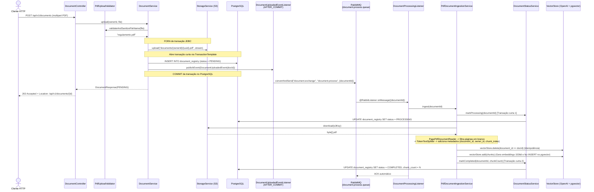
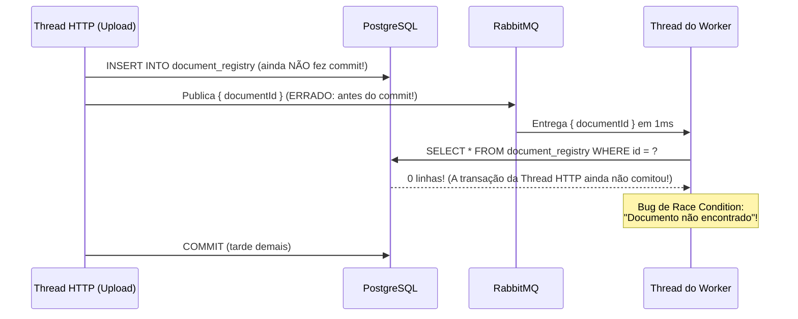
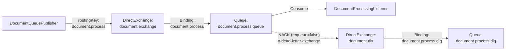

# Guia Didático — Fases 3 e 4: Documentos, S3, Fila RabbitMQ e Worker RAG (`ai-copilot`)

Este documento explica em profundidade a implementação das **Fases 3 e 4** do projeto `ai-copilot`. Ele foi escrito sob medida para um desenvolvedor experiente em **Node.js/NestJS** (que já conhece BullMQ, Kafka, AWS SDK JS e RAG com LangChain.js/pgvector) e que está aprendendo **Java 21, Spring Boot 3.5, Spring AMQP e Spring AI 1.1.8**.

---

## 1. Visão geral

Construímos um pipeline assíncrono completo de upload, armazenamento em nuvem, mensageria e ingestão RAG (*Retrieval-Augmented Generation*) para arquivos PDF:

1. O cliente envia o PDF via `POST /api/v1/documents` (`multipart/form-data`).
2. A API valida o arquivo (incluindo os *magic bytes* `%PDF-`), faz upload para o **Amazon S3** **fora** de transação de banco, grava o registro `DocumentRegistry` com status `PENDING` em uma transação curta usando `TransactionTemplate` (com compensação no S3 caso o banco falhe) e responde imediatamente **`202 Accepted`** com o cabeçalho `Location`.
3. **Somente após o commit** da transação no PostgreSQL (`AFTER_COMMIT`), um listener interno publica uma mensagem JSON no **RabbitMQ** (`document.exchange` → `document.process.queue`).
4. O worker (`DocumentProcessingListener`) consome a mensagem, marca o documento como `PROCESSING`, baixa os bytes do S3, extrai o texto página por página (`PagePdfDocumentReader`), divide em chunks (`TokenTextSplitter`), enriquece os metadados (`document_id`, `owner_id`, `chunk_index`), remove vetores antigos daquele documento (idempotência), gera os embeddings na **OpenAI** salvando-os na tabela `vector_store` (**pgvector**) e marca o documento como `COMPLETED`.

### Diagrama de sequência do fluxo completo



---

## 2. Mapa Nest/Node → Spring desta fase

| Conceito no NestJS / Node.js | Equivalente no Spring Boot (Fases 3 e 4) | Onde está no nosso código |
|---|---|---|
| `@UseInterceptors(FileInterceptor('file'))` + `@UploadedFile() file: Express.Multer.File` | `@RequestParam("file") MultipartFile file` | `DocumentController.upload` |
| `@aws-sdk/client-s3` (`S3Client`, `PutObjectCommand`, `GetObjectCommand`, `DeleteObjectCommand`) | `software.amazon.awssdk:s3` (`S3Client`, `PutObjectRequest`, `GetObjectRequest`, `DeleteObjectRequest`) | `S3Config` e `S3StorageService` |
| `@nestjs/event-emitter` (`eventEmitter.emit(...)` + `@OnEvent(...)`) | `ApplicationEventPublisher` + `@TransactionalEventListener(phase = AFTER_COMMIT)` | `DocumentService`, `DocumentUploadedEvent` e `DocumentUploadedEventListener` |
| `queue.add('process', { documentId })` do BullMQ / `producer.send` do KafkaJS | `rabbitTemplate.convertAndSend(exchange, routingKey, message)` | `DocumentQueuePublisher` |
| `@Processor('documents')` + `@Process('process')` do `@nestjs/bullmq` | `@RabbitListener(queues = "${app.messaging.document.queue}")` | `DocumentProcessingListener` |
| `PDFLoader` + `TokenTextSplitter` do LangChain.js (`@langchain/community`) | `PagePdfDocumentReader` + `TokenTextSplitter` do Spring AI | `PdfDocumentIngestionService` e `IngestionConfig` |
| `PGVectorStore.fromDocuments(...)` / `vectorStore.addDocuments(...)` do LangChain.js | `VectorStore` (`PgVectorStore` autoconfigurado pelo Spring AI) | `PdfDocumentIngestionService` |

---

## 3. Conceitos de Java que apareceram

Abaixo estão todos os conceitos novos da linguagem Java que surgiram nas Fases 3 e 4, seguindo a estrutura: **o que é → por que existe → equivalente no Nest/Node → trecho de código comentado**.

---

### 3.1 `enum`

- **O que é:** Um tipo especial de classe que representa um conjunto fixo e fechado de constantes conhecidas em tempo de compilação (`PENDING`, `PROCESSING`, `COMPLETED`, `FAILED`).
- **Por que existe:** Evita "strings mágicas" espalhadas pelo código (ex.: escrever `"COMPLETD"` errado em algum lugar) e permite validação estática pelo compilador. Combinado com `@Enumerated(EnumType.STRING)` no JPA, o Hibernate grava o nome textual da constante (`"PENDING"`) no banco de dados (e não o número ordinal `0, 1, 2`, que quebraria se alguém reordenasse o enum).
- **Equivalente no Nest/Node:** `enum DocumentStatus { PENDING = 'PENDING', ... }` ou union type `'PENDING' | 'PROCESSING' | 'COMPLETED' | 'FAILED'` no TypeScript.
- **Trecho de código comentado** (`src/main/java/br/com/igor/copilot/document/DocumentStatus.java` e `DocumentRegistry.java`):

```java
// Declaração do enum
public enum DocumentStatus {
    PENDING,
    PROCESSING,
    COMPLETED,
    FAILED
}

// Uso na entidade JPA:
// EnumType.STRING é obrigatório! Sem ele, o padrão do JPA seria EnumType.ORDINAL (gravaria 0, 1, 2, 3),
// o que violaria a constraint CHECK da tabela e tornaria o banco ilegível.
@Enumerated(EnumType.STRING)
@Column(nullable = false, length = 20)
private DocumentStatus status;
```

---

### 3.2 Classe anônima (*Anonymous Class*) — o caso do `ByteArrayResource`

- **O que é:** Uma sintaxe do Java que permite declarar e instanciar uma subclasse sem nome no mesmo lugar da expressão `new SuperClasse(...) { @Override ... }`, sobrescrevendo apenas o método necessário.
- **Por que existe:** Quando precisamos adaptar um único método de uma classe existente pontualmente, sem criar um arquivo `.java` inteiro novo no projeto só para 5 linhas de código.
- **Por que precisamos dela no `PdfDocumentIngestionService`:** O `PagePdfDocumentReader` do Spring AI recebe um `Resource` e lê `resource.getFilename()` para gravar nos metadados do `Document` (`file_name`). Como baixamos o PDF do S3 como um array de bytes em memória (`byte[]`), usamos `ByteArrayResource`. Porém, a implementação padrão de `ByteArrayResource.getFilename()` retorna sempre `null`, e o `Document` do Spring AI lança exceção se qualquer valor de metadado for `null`! Sobrescrevendo `getFilename()` numa classe anônima, entregamos o nome real do arquivo (`doc.fileName()`).
- **Equivalente no Nest/Node:** Em JavaScript/TypeScript você faria *monkey-patching* direto na instância (`const res = new ByteArrayResource(pdf); res.getFilename = () => fileName;`) ou passaria um objeto literal compatível com a interface. Como o Java tem tipagem nominal estrita, criamos uma subclasse anônima na hora.
- **Trecho de código comentado** (`src/main/java/br/com/igor/copilot/document/ingestion/PdfDocumentIngestionService.java`):

```java
// Note as chaves { ... } logo após new ByteArrayResource(pdf):
// estamos criando em tempo real uma subclasse anônima de ByteArrayResource
// que sobrescreve o método getFilename() para devolver o fileName do nosso snapshot.
Resource resource = new ByteArrayResource(pdf) {
    @Override
    public String getFilename() {
        return fileName;
    }
};
```

---

### 3.3 `try-with-resources` e `InputStream`

- **O que é:**
  - `InputStream` é a abstração padrão do Java para um fluxo de leitura de bytes (como uma *Readable Stream* do Node.js).
  - `try (Recurso r = ...) { ... }` (*try-with-resources*) é uma estrutura da linguagem Java para qualquer objeto que implemente `AutoCloseable` (streams de arquivo, conexões de rede, documentos do PDFBox). O compilador garante que `r.close()` será chamado automaticamente na saída do bloco `try`, mesmo que uma exceção seja lançada no meio.
- **Por que existe:** Evita vazamento de descritores de arquivo, memória nativa e buffers de I/O (*resource leaks*), sem precisar escrever blocos `finally { if (in != null) in.close(); }` verbosos.
- **Equivalente no Nest/Node:** `using` do TypeScript 5.2+ (`Symbol.dispose`) ou um bloco `try { ... } finally { stream.destroy(); }`.
- **Trecho de código comentado** (`src/main/java/br/com/igor/copilot/document/PdfUploadValidator.java`):

```java
private void validateMagicBytes(MultipartFile file) {
    // O InputStream é aberto dentro dos parênteses do try(...).
    // Assim que o bloco termina (normalmente ou por throw), o Java fecha o stream automaticamente.
    try (InputStream in = file.getInputStream()) {
        byte[] header = in.readNBytes(PDF_MAGIC_BYTES.length);
        if (!Arrays.equals(header, PDF_MAGIC_BYTES)) {
            throw new InvalidDocumentException("O arquivo enviado não possui assinatura binária de PDF (%PDF-)");
        }
    } catch (IOException e) {
        throw new InvalidDocumentException("Não foi possível ler o arquivo enviado", e);
    }
}
```

---

### 3.4 `byte[]`

- **O que é:** Um array primitivo de bytes na memória da JVM (cada `byte` em Java é um inteiro com sinal de 8 bits, de `-128` a `127`).
- **Por que existe:** Para representar dados binários brutos (como os bytes de um PDF baixado do S3 ou gerado pelo PDFBox) de forma compacta e contígua na memória.
- **Equivalente no Nest/Node:** `Buffer` do Node.js ou `Uint8Array` do JavaScript.
- **Trecho de código comentado** (`src/main/java/br/com/igor/copilot/storage/S3StorageService.java`):

```java
@Override
public byte[] download(String key) {
    try {
        GetObjectRequest request = GetObjectRequest.builder()
                .bucket(props.s3Bucket())
                .key(key)
                .build();
        // Baixa o conteúdo do objeto S3 como um array de bytes (byte[]) em memória
        return s3Client.getObjectAsBytes(request).asByteArray();
    } catch (SdkException e) {
        throw new StorageException("Falha ao baixar arquivo do S3: " + key, e);
    }
}
```

---

### 3.5 `String.formatted(...)`

- **O que é:** Método de instância introduzido no Java 15 para interpolar valores em uma string de template usando especificadores como `%s` (string/objeto) e `%d` (inteiro).
- **Por que existe:** Como o Java não possui *template literals* com `${variavel}` como o JavaScript, `"documents/%s/%s.pdf".formatted(ownerId, UUID.randomUUID())` é a forma moderna, limpa e legível de montar strings formatadas sem concatenações confusas com `+`.
- **Equivalente no Nest/Node:** Template literal `` `documents/${ownerId}/${randomUUID()}.pdf` ``.
- **Trecho de código comentado** (`src/main/java/br/com/igor/copilot/document/DocumentService.java`):

```java
// Cada %s é substituído, na ordem, pelos argumentos passados para .formatted(...)
String s3Key = "documents/%s/%s.pdf".formatted(ownerId, UUID.randomUUID());
```

---

### 3.6 Records aninhados (`MessagingProperties.DocumentQueue`)

- **O que é:** Um `record` declarado dentro de outro `record` (em Java, um `record` aninhado é implicitamente `static`, ou seja, não depende de uma instância da classe externa para existir).
- **Por que existe:** Para refletir estruturas hierárquicas do `application.yml` (`app.messaging.document.exchange`, `app.messaging.document.queue` etc.) mantendo o código coeso num único arquivo quando o sub-objeto só faz sentido dentro daquela configuração.
- **Equivalente no Nest/Node:** Interfaces aninhadas ou objetos tipados dentro do retorno de `registerAs('messaging', () => ({ document: { ... } }))`.
- **Trecho de código comentado** (`src/main/java/br/com/igor/copilot/document/messaging/MessagingProperties.java`):

```java
@Validated
@ConfigurationProperties(prefix = "app.messaging")
public record MessagingProperties(
        @Valid // Importante! Sem @Valid aqui, o Spring validaria apenas se 'document' não é nulo, sem validar os campos internos de DocumentQueue
        @NotNull(message = "A configuração da fila de documentos é obrigatória")
        DocumentQueue document
) {
    // Mapeia o sub-bloco app.messaging.document.* do application.yml
    public record DocumentQueue(
            @NotBlank(message = "O nome da exchange é obrigatório") String exchange,
            @NotBlank(message = "A routing key é obrigatória") String routingKey,
            @NotBlank(message = "O nome da fila principal é obrigatório") String queue,
            @NotBlank(message = "O nome da dead-letter exchange é obrigatório") String deadLetterExchange,
            @NotBlank(message = "O nome da dead-letter queue é obrigatório") String deadLetterQueue
    ) {
    }
}
```

---

### 3.7 Meta-anotações (`@IntegrationTest`)

- **O que é:** Uma anotação customizada (`public @interface IntegrationTest`) que é ela própria anotada com várias outras anotações do Spring e do JUnit (`@SpringBootTest`, `@AutoConfigureMockMvc`, `@Import`, `@ActiveProfiles`).
- **Por que existe:**
  1. Evita repetir 5 anotações no topo de toda classe de teste de integração.
  2. **Vantagem oculta de performance:** o Spring Test faz *cache* do `ApplicationContext` entre classes de teste que possuem exatamente a mesma configuração de anotações. Ao padronizar todas as classes (`AiCopilotApplicationTests`, `AuthFlowIntegrationTest`, `DocumentFlowIntegrationTest`) com `@IntegrationTest`, o Spring sobe os containers e o contexto **uma única vez** para toda a bateria de testes!
- **Equivalente no Nest/Node:** `applyDecorators(...)` do `@nestjs/common`.
- **Trecho de código comentado** (`src/test/java/br/com/igor/copilot/support/IntegrationTest.java`):

```java
@Target(ElementType.TYPE)            // Pode ser usada apenas em classes/interfaces
@Retention(RetentionPolicy.RUNTIME)  // Permanece disponível em runtime para o JUnit/Spring ler via reflexão
@SpringBootTest
@AutoConfigureMockMvc
@Import({TestcontainersConfiguration.class, TestFakesConfiguration.class})
@ActiveProfiles("test")
@TestConstructor(autowireMode = TestConstructor.AutowireMode.ALL)
public @interface IntegrationTest {
}
```

---

### 3.8 Polimorfismo via Interface (`StorageService` e `EmbeddingModel`)

- **O que é:** Capacidade de um serviço (`DocumentService` ou `PdfDocumentIngestionService`) depender apenas de uma **interface** (`StorageService`), permitindo que o container IoC do Spring injete `S3StorageService` em produção e `InMemoryStorageService` (marcado com `@Primary`) nos testes de integração.
- **Por que existe:** Desacoplamento total de infraestrutura externa. Nenhuma linha de `DocumentService` ou `PdfDocumentIngestionService` sabe se está falando com a AWS real ou com um `ConcurrentHashMap` em memória.
- **Equivalente no Nest/Node:** `.overrideProvider(StorageService).useClass(InMemoryStorageService)` no `Test.createTestingModule` do NestJS.

---

### 3.9 `Optional` com `isEmpty()` e `get()`

- **O que é:** Além do estilo funcional (`.map()`, `.orElseThrow()`), o `Optional` permite verificação imperativa de guarda (*guard clause*) com `if (snapshot.isEmpty()) { return; }` seguida de `snapshot.get()`.
- **Por que existe:** Em fluxos procedurais de várias etapas como `PdfDocumentIngestionService.ingest`, fazer um *early return* quando `markProcessing` retorna vazio deixa o código plano (sem aninhar todo o método dentro de um `.ifPresent(doc -> { ... })`).
- **Equivalente no Nest/Node:** *Type narrowing* no TypeScript: `if (!snapshot) return; // daqui para baixo o TS sabe que snapshot não é null`.
- **Trecho de código comentado** (`src/main/java/br/com/igor/copilot/document/ingestion/PdfDocumentIngestionService.java`):

```java
Optional<DocumentProcessingSnapshot> snapshot = statusService.markProcessing(documentId);
if (snapshot.isEmpty()) {
    return; // Documento não existe ou já estava COMPLETED: encerra silenciosamente
}
// Como já verificamos isEmpty() acima, chamar snapshot.get() aqui é 100% seguro
DocumentProcessingSnapshot doc = snapshot.get();
```

---

## 4. Arquivo por arquivo, na ordem de construção

### 4.1 `src/main/resources/db/migration/V3__document_processing.sql`
- **Papel:** Adiciona `updated_at` e `chunk_count` em `document_registry`, cria índice por `owner_id` e cria o índice **GIN (`jsonb_path_ops`)** sobre a coluna `metadata` da tabela `vector_store`.
- **Equivalente no Nest/Node:** Migration SQL do TypeORM/Prisma.

### 4.2 `src/main/java/br/com/igor/copilot/shared/security/CurrentUser.java`
- **Papel:** Extrai centralizadamente o `UUID` do usuário a partir do `jwt.getSubject()`.
- **Equivalente no Nest/Node:** Custom param decorator `@CurrentUser()` que lê `req.user.sub`.

### 4.3 Módulo `storage` (`AwsProperties`, `S3Config`, `StorageService`, `StorageException`, `S3StorageService`)
- **Papel:** Encapsula toda a comunicação com o Amazon S3 usando o AWS SDK para Java v2.
- **Detalhe importante sobre o nome da entidade:** A entidade de documentos no pacote `document` foi batizada de `DocumentRegistry` (e não `Document`) porque o Spring AI possui a classe `org.springframework.ai.document.Document` (que representa um trecho/página de texto com metadados). Se ambas se chamassem `Document`, teríamos colisão de imports e leitura confusa no worker.

### 4.4 `DocumentStatus`, `DocumentRegistry`, `DocumentRegistryRepository`, `DocumentStatusService`
- **Papel:** Modelagem da máquina de estados do documento (`PENDING` → `PROCESSING` → `COMPLETED` / `FAILED`) e persistência em transações curtas.
- **Por que `ownerId` é um `UUID` puro e não `@ManyToOne User`?** Em um design modular (preparado inclusive para extração futura em microsserviços), o módulo `document` não precisa navegar para o objeto `User` nem carregar e-mail/senha: ele só precisa validar e filtrar pelo `UUID` do dono (`WHERE id = ? AND owner_id = ?`). Isso elimina joins desnecessários e evita armadilhas de `FetchType.LAZY`.

### 4.5 `PdfUploadValidator`, `DocumentUploadedEvent`, `DocumentResponse`, `DocumentService`, `DocumentController`
- **Papel:** Camada HTTP e de aplicação para receber o multipart, validar cabeçalho e assinatura binária `%PDF-`, enviar ao S3, persistir o registro com `TransactionTemplate`, disparar o evento interno e expor os endpoints de consulta.

### 4.6 Módulo `document.messaging` (`MessagingProperties`, `DocumentMessagingConfig`, `DocumentProcessingMessage`, `DocumentQueuePublisher`, `DocumentUploadedEventListener`, `DocumentProcessingListener`)
- **Papel:** Declaração automática da topologia RabbitMQ (Exchange principal, Dead-Letter Exchange, Fila principal e Dead-Letter Queue), publicação após o commit do banco e consumo assíncrono com tratamento diferenciado para falhas permanentes versus falhas inesperadas.

### 4.7 Módulo `document.ingestion` (`VectorMetadata`, `IngestionProperties`, `IngestionConfig`, `DocumentProcessingSnapshot`, `UnprocessableDocumentException`, `DocumentIngestionService`, `PdfDocumentIngestionService`)
- **Papel:** Pipeline RAG completo: leitura do PDF página a página, filtragem de páginas em branco, *chunking* por tokens (`TokenTextSplitter`), enriquecimento de metadados (`document_id`, `owner_id`, `chunk_index`), limpeza prévia por `document_id` e inserção vetorial no `pgvector`.

### 4.8 `GlobalExceptionHandler`
- **Papel:** Mapeia `InvalidDocumentException` (400), `DocumentNotFoundException` (404), `StorageException` (503) e sobrescreve `handleMaxUploadSizeExceededException` da superclasse `ResponseEntityExceptionHandler` para devolver `413 Payload Too Large` com `"Arquivo excede o tamanho máximo de 20MB"`.
- **Por que sobrescrevemos `handleMaxUploadSizeExceededException` em vez de usar `@ExceptionHandler(MaxUploadSizeExceededException.class)`?** Porque no Spring Framework 6 a classe base `ResponseEntityExceptionHandler` já declara `@ExceptionHandler` para `MaxUploadSizeExceededException`. Se adicionássemos outro `@ExceptionHandler` para a mesma classe na subclasse, o Spring falharia na subida com `IllegalStateException: Ambiguous @ExceptionHandler method mapped for [class MaxUploadSizeExceededException]`.

---

## 5. Transações em profundidade

### 5.1 Por que NUNCA fazer chamadas de rede (S3 / OpenAI) dentro de `@Transactional`?
O pool de conexões do PostgreSQL (HikariCP) tem, por padrão, apenas **10 conexões físicas**. Quando um método anotado com `@Transactional` começa a executar e faz uma query, ele pega 1 dessas 10 conexões emprestada e só a devolve no `COMMIT` ou `ROLLBACK`.
- Se você fizesse o upload para o S3 (digamos, 2 segundos) ou a chamada de embeddings na OpenAI (digamos, 4 segundos) **dentro** de um método `@Transactional`, apenas **10 uploads simultâneos esgotariam 100% do banco de dados**, travando até mesmo o login de outros usuários (`Connection is not available, request timed out`).
- Por isso, no nosso código:
  - Em `DocumentService.upload`, enviamos o arquivo para o S3 **antes** de abrir a transação, e abrimos a transação apenas por ~2 milissegundos para o `INSERT`.
  - No worker (`PdfDocumentIngestionService`), `ingest` **não** é `@Transactional`: abrimos uma transação curta de ~2ms em `statusService.markProcessing`, fechamos a transação, fazemos o download do S3 e chamamos a OpenAI sem segurar transação JPA, e depois abrimos outra transação curta de ~2ms em `statusService.markCompleted`.

---

### 5.2 `TransactionTemplate` versus `@Transactional` e o problema da *self-invocation*
Por que em `DocumentService.upload` usamos `transactionTemplate.execute(...)` em vez de criar um método auxiliar `salvarNoBanco(...)` anotado com `@Transactional` dentro do próprio `DocumentService`?
- Lembre-se da Fase 2: o `@Transactional` funciona por meio de um **Proxy** que envolve a instância de `DocumentService`.
- Quando o `DocumentController` chama `documentService.upload(...)`, a chamada passa pelo Proxy.
- Mas quando um método de `DocumentService` chama outro método da **própria classe** (`this.salvarNoBanco()`), a chamada vai direto para `this`, **sem passar pelo Proxy** (*self-invocation*). Qualquer `@Transactional` nesse método interno seria completamente ignorado pelo Spring!
- Usando `TransactionTemplate` injetado pelo construtor, abrimos e fechamos a transação programaticamente exatamente no bloco lambda desejado, sem depender de proxy.

---

### 5.3 `@TransactionalEventListener(phase = AFTER_COMMIT)` — por que publicar na fila antes do commit causa bugs graves?
Imagine o que aconteceria se publicássemos a mensagem no RabbitMQ **dentro** da transação, logo após `repository.save(...)`, antes do `COMMIT` no PostgreSQL:



Ao publicarmos um evento em memória (`eventPublisher.publishEvent(new DocumentUploadedEvent(id))`) e escutá-lo com `@TransactionalEventListener(phase = TransactionPhase.AFTER_COMMIT)`, o Spring **segura o evento na memória** e só executa `publisher.publish(event.documentId())` **depois que o PostgreSQL confirmou o `COMMIT` da transação**. Quando o worker recebe a mensagem do RabbitMQ, é 100% garantido que a linha já está visível no banco.

---

### 5.4 Por que `markFailed` exige `Propagation.REQUIRES_NEW`?
E se o banco fizer o `COMMIT` com sucesso, o `DocumentUploadedEventListener` for acionado na fase `AFTER_COMMIT`, mas o RabbitMQ estiver fora do ar naquele instante?
- O `DocumentQueuePublisher` captura a `AmqpException` e chama `statusService.markFailed(documentId, "Não foi possível enfileirar...")` para não deixar o documento preso eternamente em `PENDING`.
- Porém, dentro de um callback `AFTER_COMMIT`, a sincronização da transação anterior do Spring ainda está ativa na thread, mas **a transação física já fez commit**! Se `markFailed` usasse `@Transactional` padrão (`Propagation.REQUIRED`), o Spring tentaria reaproveitar a transação já encerrada e nenhum `UPDATE` seria comitado.
- Com `@Transactional(propagation = Propagation.REQUIRES_NEW)`, o Spring suspende o contexto antigo, abre uma **transação física novíssima**, grava `status = FAILED` e faz commit imediatamente.

---

### 5.5 A compensação no S3
Como não existe transação distribuída (2PC) entre o Amazon S3 e o PostgreSQL, usamos o padrão de **Compensação** (base do padrão *Saga*):
1. Fazemos o upload no S3 primeiro.
2. Tentamos gravar no banco dentro do `try`.
3. Se o banco lançar qualquer `RuntimeException`, o bloco `catch` executa `deleteQuietly(s3Key)` removendo o arquivo recém-enviado do S3 antes de relançar o erro para o cliente. Assim, nunca deixamos objetos órfãos cobrando armazenamento no bucket.

---

## 6. RabbitMQ em profundidade

### 6.1 Exchange, Fila, Binding, Routing Key, DLX e DLQ

No BullMQ (Redis), você publica direto na fila (`queue.add`). No RabbitMQ (protocolo AMQP 0-9-1), **o produtor nunca publica direto em uma fila**: ele sempre publica em uma **Exchange**, passando uma **Routing Key**, e a Exchange roteia a mensagem para uma ou mais filas através de regras chamadas **Bindings**.



- **Fila Principal (`document.process.queue`):** declarada com os argumentos `x-dead-letter-exchange = document.dlx` e `x-dead-letter-routing-key = document.process.dlq`.
- **Dead-Letter Exchange (`document.dlx`) e Dead-Letter Queue (`document.process.dlq`):** quando o worker rejeita uma mensagem sem reenfileirar (`AmqpRejectAndDontRequeueException`), o próprio RabbitMQ move automaticamente a mensagem para a `document.process.dlq`, onde ela fica guardada com os cabeçalhos originais do erro para inspeção ou reprocessamento.

---

### 6.2 Configurações do Listener no `application.yml`

```yaml
spring:
  rabbitmq:
    listener:
      simple:
        acknowledge-mode: auto
        default-requeue-rejected: false
        prefetch: 1
        concurrency: 1
        max-concurrency: 3
```

- **`acknowledge-mode: auto`:** o Spring gerencia o `ACK`/`NACK` automaticamente: se o método `@RabbitListener` retornar sem exceção, o Spring envia `basic.ack` ao RabbitMQ (removendo a mensagem da fila); se lançar exceção, envia `basic.nack`.
- **`default-requeue-rejected: false`:** impede loops infinitos (*poison message loop*). Se uma mensagem falhar com exceção, ela **não** volta para a fila principal; vai direto para a DLQ.
- **`prefetch: 1`:** fundamental para workers pesados de IA/PDF! Sem `prefetch: 1` (o padrão do Spring AMQP é 250), um único consumidor pegaria 250 mensagens da fila para a memória RAM de uma vez só enquanto outras instâncias ficariam ociosas. Com `prefetch: 1`, o RabbitMQ só entrega a próxima mensagem ao worker depois que ele terminar e confirmar (`ack`) a atual.
- **`concurrency: 1` e `max-concurrency: 3`:** inicia com 1 thread consumidora e escala automaticamente até 3 threads concorrentes conforme o volume da fila cresce.

---

### 6.3 Comparação: RabbitMQ vs. BullMQ vs. Kafka

| Aspecto | RabbitMQ (nosso projeto) | BullMQ (Node.js + Redis) | Apache Kafka |
|---|---|---|---|
| **Modelo** | Message Broker tradicional (filas inteligentes, roteamento via Exchanges). | Filas de jobs em cima do Redis. | Log distribuído de eventos (partições ordenadas). |
| **Retenção da mensagem** | Apagada da fila assim que recebe `ACK`. | Movida para conjunto `completed`/`failed` no Redis. | Mantida no disco pelo tempo configurado (ex.: 7 dias), independente do consumo. |
| **Controle de pressão (*Backpressure*)** | `prefetch: 1` por canal AMQP. | `concurrency` no Worker. | `max.poll.records` por consumidor da partição. |
| **Dead-Letter Queue** | Nativa do protocolo no broker (`x-dead-letter-exchange`). | `failed` state no Redis. | Implementada na aplicação publicando num tópico `.DLT`. |

---

### 6.4 Semântica *At-Least-Once*, Idempotência e onde fica o Retry
- **Por que a mesma mensagem pode chegar duas vezes (*at-least-once*)?** Se o worker terminar de gravar os vetores no PostgreSQL, mas a conexão com o RabbitMQ cair um milissegundo antes de o `ACK` chegar ao broker, o RabbitMQ devolverá a mensagem para a fila e outro worker a processará novamente.
- **Como garantimos idempotência:**
  1. Se o `markProcessing` já encontrar o documento como `COMPLETED`, ele ignora a mensagem e retorna `Optional.empty()`.
  2. Se a falha anterior aconteceu antes do `markCompleted` (deixando vetores pela metade na `vector_store`), o `PdfDocumentIngestionService` executa `vectorStore.delete(byDocumentId(documentId))` **antes** de chamar `vectorStore.add(chunks)`.
- **Por que o retry fica nos clientes (`spring.ai.retry` e AWS SDK) e não no `@RabbitListener`?** Se a API da OpenAI sofrer um *rate limit* momentâneo (HTTP 429) no momento de gerar os embeddings, repetir toda a mensagem do RabbitMQ obrigaria a baixar o PDF do S3 de novo, fazer o parse do PDFBox de novo e dividir os chunks de novo. Deixando o retry com *exponential backoff* (`spring.ai.retry.max-attempts: 3`, `initial-interval: 2s`) no cliente HTTP da OpenAI (e no cliente S3), apenas a chamada de rede que falhou é repetida instantaneamente.

---

### 6.5 Como inspecionar a DLQ no painel do RabbitMQ
1. Acesse `http://localhost:15672` (usuário `copilot`, senha `copilot`).
2. Clique na aba **Queues and Streams**.
3. Você verá as filas `document.process.queue` (com a badge `DLX` e `DLK` ativas) e `document.process.dlq`.
4. Clicando em `document.process.dlq` → seção **Get messages** → botão **Get Message(s)**, você pode inspecionar o JSON `{ "documentId": "..." }` e os headers `x-death` com o motivo e horário exato da falha.


---

## 7. Ingestão RAG em profundidade

### 7.1 Leitura por página (`PagePdfDocumentReader`) e os metadados de página
- O `PagePdfDocumentReader` (baseado no Apache PDFBox) lê o PDF página por página e devolve um `List<Document>`, onde cada `Document` do Spring AI representa uma página e já vem com os metadados:
  - `page_number` (`PagePdfDocumentReader.METADATA_START_PAGE_NUMBER`): número da página inicial (começando em 1);
  - `file_name`: nome do arquivo retornado pelo nosso `ByteArrayResource`.
- Antes do *chunking*, filtramos páginas em branco com `.filter(page -> StringUtils.hasText(page.getText()))`. Se todas as páginas estiverem em branco, lançamos `UnprocessableDocumentException` avisando que o PDF provavelmente é digitalizado (imagem) e exigiria OCR.

---

### 7.2 O `TokenTextSplitter` (e a comparação com `RecursiveCharacterTextSplitter`)
- **Como funciona o `TokenTextSplitter`:** Ele usa a biblioteca `jtokkit` (o port oficial do `tiktoken` da OpenAI para Java) para contar **tokens reais do modelo** (`cl100k_base`), e não apenas caracteres. Quando uma página excede `chunkSize` (800 tokens), ele procura o último sinal de pontuação (`.`, `?`, `!`, `\n`) acima de `minChunkSizeChars` (350 caracteres) para cortar o texto sem quebrar frases ao meio.
- **Diferença em relação ao `RecursiveCharacterTextSplitter` do LangChain.js:** O `TokenTextSplitter` do Spring AI divide por contagem exata de tokens e pontuação, mas **não possui parâmetro de sobreposição (`chunkOverlap`)**. Já o `RecursiveCharacterTextSplitter` do LangChain mede em caracteres e permite `chunkOverlap` (repetir os últimos ~100 caracteres no próximo chunk). Para a maioria dos documentos corporativos, o corte em fronteira de frase do `TokenTextSplitter` com 800 tokens preserva bem o contexto semântico e garante que nenhum chunk ultrapasse o limite de tokens do modelo de embedding.

---

### 7.3 Metadados de posse (`document_id`, `owner_id`, `chunk_index`) e por que eles importam para a Fase 5
No método `withMetadata`, copiamos os metadados originais da página (`page_number`, `file_name`) e adicionamos três chaves definidas em `VectorMetadata`:
- `document_id`: UUID do documento em String;
- `owner_id`: UUID do usuário dono do documento em String;
- `chunk_index`: posição sequencial do chunk (`0, 1, 2...`).

**Por que `owner_id` no JSONB de cada vetor é indispensável para a Fase 5 (Chat RAG)?**
Na tabela `vector_store`, os chunks de **todos os usuários** convivem na mesma tabela para aproveitar o índice vetorial HNSW. Quando o Usuário A fizer uma pergunta no chat na Fase 5, o filtro de busca semântica (`FilterExpressionBuilder`) adicionará obrigatoriamente `owner_id == usuarioA` (e opcionalmente `document_id == docEscolhido`). Isso garante **isolamento multi-tenant**: o LLM jamais lerá trechos de PDFs de outros usuários!

---

### 7.4 Delete por filtro no JSONB e o índice GIN `jsonb_path_ops`
Quando chamamos:
```java
vectorStore.delete(new FilterExpressionBuilder().eq(VectorMetadata.DOCUMENT_ID, id.toString()).build());
```
O `PgVectorStore` traduz essa expressão para uma query SQL com JSONPath no PostgreSQL sobre a coluna `metadata` (`JSONB`). Sem índice, esse `DELETE` (e o filtro do chat na Fase 5) faria um *Sequential Scan* na tabela `vector_store` inteira.
Por isso, na migration `V3__document_processing.sql`, criamos:
```sql
CREATE INDEX idx_vector_store_metadata ON vector_store USING GIN (metadata jsonb_path_ops);
```
O índice **GIN (*Generalized Inverted Index*)** com a classe de operadores `jsonb_path_ops` cria entradas de hash compactas para cada caminho/valor dentro do JSONB (`document_id`, `owner_id`), tornando buscas e deleções por metadado instantâneas mesmo com milhões de chunks.

---

### 7.5 Índice HNSW com distância de cosseno e lote de embeddings
- **Lote (*Batching*) no `vectorStore.add(chunks)`:** Quando passamos uma lista de, digamos, 15 chunks para `vectorStore.add(chunks)`, o `PgVectorStore` **não** faz 15 chamadas HTTP separadas para a OpenAI. Ele usa a estratégia de *batching* do Spring AI para enviar os textos em lote numa única requisição para `POST /v1/embeddings` (modelo `text-embedding-3-small`, 1536 dimensões) e em seguida faz batch insert via JDBC na tabela `vector_store`.
- **Índice HNSW (`vector_cosine_ops`):** Criado na V1 (`USING HNSW (embedding vector_cosine_ops)`), organiza os vetores de 1536 dimensões em um grafo navegável hierárquico (*Hierarchical Navigable Small World*), permitindo encontrar os $K$ trechos semanticamente mais próximos em poucos milissegundos usando distância de cosseno (`<=>`).

---

## 8. Segurança

1. **Bytes mágicos (`%PDF-`) vs. `Content-Type`:** Um usuário malicioso pode renomear um executável ou script `.html` para `contrato.pdf` e forçar `Content-Type: application/pdf` no comando `curl`. O `PdfUploadValidator` abre o `InputStream` e verifica se os 5 primeiros bytes batem exatamente com `0x25 0x50 0x44 0x46 0x2D` (`%PDF-`).
2. **Sanitização do nome do arquivo (*Path Traversal*):** Clientes maliciosos podem enviar `filename="../../etc/passwd.pdf"` ou `C:\Windows\win.ini`. Aplicamos `StringUtils.cleanPath`, removemos tudo até a última `/` ou `\` e truncamos em 255 caracteres.
3. **Chave do S3 nunca controlada pelo usuário:** O nome original sanitizado serve apenas para exibição no frontend (`fileName`). No S3, a chave é sempre gerada pelo servidor no formato `"documents/%s/%s.pdf".formatted(ownerId, UUID.randomUUID())`, eliminando qualquer risco de sobrescrita de arquivos ou injeção de caminho no bucket.
4. **404 versus 403 na verificação de posse (IDOR):** Em `GET /api/v1/documents/{id}`, buscamos com `findByIdAndOwnerId(id, ownerId)`. Se o documento pertencer a outro usuário, retornamos **404 Not Found** (`"Documento não encontrado"`) em vez de 403 Forbidden. Retornar 403 revelaria a um atacante que aquele UUID existe no sistema.
5. **Limite de upload (20 MB):** Configurado em `spring.servlet.multipart.max-file-size: 20MB` e `max-request-size: 20MB`, e tratado no `GlobalExceptionHandler` com status `413 Payload Too Large`.
6. **Por que as credenciais da AWS não vão no `.env`?** O `spring.config.import: optional:file:.env[.properties]` carrega as chaves do `.env` para dentro do `Environment` do Spring, mas **não** altera as variáveis de ambiente do processo no sistema operacional (`System.getenv()`). O `DefaultCredentialsProvider` do AWS SDK busca credenciais em `System.getenv("AWS_ACCESS_KEY_ID")` ou no arquivo `~/.aws/credentials` (criado pelo comando `aws configure`). Além disso, manter as credenciais da AWS no perfil local da máquina evita qualquer risco de commitar chaves IAM no projeto.

---

## 9. O que eu faria em produção (Evoluções arquiteturais para citar em entrevistas)

1. **Transactional Outbox Pattern + Publisher Confirms:** No nosso código atual, usamos `@TransactionalEventListener(phase = AFTER_COMMIT)`. Se a JVM sofrer um `kill -9` ou queda de energia exatamente no milissegundo entre o `COMMIT` no Postgres e o `convertAndSend` no RabbitMQ, a mensagem não seria enviada. Em sistemas críticos de altíssima escala, gravamos o evento numa tabela `outbox_events` na **mesma transação** do `DocumentRegistry`, e um processo separado (ou Debezium CDC) publica no RabbitMQ com *Publisher Confirms* ativado.
2. **Upload direto para o S3 via *Presigned URL*:** Hoje o arquivo PDF passa pela memória/rede do backend Spring antes de ir ao S3. Para arquivos de centenas de megabytes, a API poderia apenas gerar uma *S3 Presigned PUT URL* com validade de 5 minutos, o frontend enviaria o binário direto para o S3 e o S3 notificaria o backend via evento `s3:ObjectCreated:Put` (SNS/SQS).
3. **OCR para PDFs escaneados:** Integrar AWS Textract, Azure Document Intelligence ou Tesseract OCR como fallback quando `readNonBlankPages` retornar vazio.
4. **Chunks com sobreposição (*Overlap*):** Caso documentos jurídicos longos precisem de janela deslizante entre trechos, implementar um `TextSplitter` customizado com `chunkOverlap` de ~100 tokens.
5. **LocalStack ou MinIO no `docker-compose.yml`:** Nosso `S3Config` já suporta a propriedade `app.aws.s3-endpoint` com `forcePathStyle(true)`! Basta apontar `S3_ENDPOINT=http://localhost:4566` para usar LocalStack localmente sem precisar de conta na AWS.
6. **Observabilidade (Métricas e Tracing distribuído):** Adicionar Micrometer + OpenTelemetry para propagar o `traceId` da requisição HTTP através dos headers da mensagem RabbitMQ até o worker, medindo latência de extração PDF e consumo de tokens da OpenAI.
7. **Reprocessamento automatizado da DLQ (*Shovel* / Endpoint Admin):** Criar uma rotina ou usar o plugin *RabbitMQ Shovel* para reenviar mensagens da `document.process.dlq` para a `document.exchange` após um incidente na OpenAI ou no S3 ser resolvido.

---

## 10. Testes: Fakes, Mocks, Awaitility e PDFs em memória

### 10.1 *Fakes* versus *Mocks*
- **Mocks (Mockito nos testes unitários):** Objetos "oco" programados com `when(...).thenReturn(...)` para verificar interações isoladas em `DocumentServiceTest`, `PdfDocumentIngestionServiceTest` e `DocumentProcessingListenerTest`.
- **Fakes (`InMemoryStorageService` e `FakeEmbeddingModel` nos testes de integração):** Implementações funcionais reais e leves da interface!
  - O `InMemoryStorageService` guarda os bytes reais do PDF em um `ConcurrentHashMap`, permitindo que o controller faça upload e o worker faça download dos mesmos bytes alguns milissegundos depois.
  - O `FakeEmbeddingModel` gera um vetor determinístico normalizado de 1536 posições (usando `new Random(text.hashCode())`), permitindo que o `PgVectorStore` real grave e consulte vetores de 1536 dimensões no PostgreSQL/pgvector do Testcontainers **sem gastar centavos na OpenAI e sem precisar de internet**.

### 10.2 Awaitility para código assíncrono (o `waitFor` do mundo Java)
Como o upload retorna `202 Accepted` imediatamente e o processamento acontece em background via RabbitMQ, não podemos fazer `assert` síncrono logo na linha seguinte (nem usar `Thread.sleep(5000)`, que deixaria os testes lentos e frágeis).
Usamos a biblioteca **Awaitility** (idêntica ao `waitFor(() => expect(...))` do Testing Library no Node/React):

```java
// Faz polling a cada 100ms (padrão) por no máximo 20 segundos até que o status mude para COMPLETED.
// Assim que o worker termina (geralmente em ~300ms), o teste passa imediatamente!
await().atMost(Duration.ofSeconds(20)).untilAsserted(() ->
        mockMvc.perform(get("/api/v1/documents/{id}", docId)
                        .header("Authorization", "Bearer " + user.accessToken()))
                .andExpect(status().isOk())
                .andExpect(jsonPath("$.status").value("COMPLETED"))
                .andExpect(jsonPath("$.chunkCount", Matchers.greaterThan(0)))
);
```

### 10.3 PDFs gerados em memória (`TestPdfs`)
Em vez de versionar arquivos `.pdf` binários na pasta `src/test/resources`, a classe `TestPdfs` usa o `PDDocument` e `PDPageContentStream` do Apache PDFBox para construir um binário PDF real (`%PDF-1.7...`) em memória em poucos milissegundos com qualquer texto que o teste precisar (`TestPdfs.withText(...)` e `TestPdfs.blankPage()`).

---

## 11. Como rodar e testar manualmente

### 11.1 Passos manuais de configuração (AWS, `.env`, RabbitMQ e PDF de exemplo)
1. **Bucket S3 e AWS CLI:**
   - Crie um bucket privado no Amazon S3 (ex.: `igor-copilot-docs`).
   - Configure suas credenciais na máquina executando:
     ```powershell
     aws configure
     ```
     (Isso salvará suas chaves em `~/.aws/credentials`, onde o `DefaultCredentialsProvider` do AWS SDK as encontrará automaticamente).
2. **Arquivo `.env` na raiz do projeto:**
   ```properties
   OPENAI_API_KEY=sk-...
   JWT_SECRET=sua-chave-secreta-com-pelo-menos-32-caracteres
   S3_BUCKET=igor-copilot-docs
   AWS_REGION=us-east-1
   ```
3. **Atenção caso a fila antiga exista no RabbitMQ local:**
   - Se você já tinha subido o projeto anteriormente e a fila `document.process.queue` já existia no seu RabbitMQ local **sem** os argumentos de Dead-Letter Exchange (`x-dead-letter-exchange`), o RabbitMQ recusará a redeclaração com o erro `PRECONDITION_FAILED`.
   - Nesse caso, abra `http://localhost:15672` (`copilot` / `copilot`), vá em **Queues and Streams**, clique em `document.process.queue` e clique em **Delete Queue** antes de subir a aplicação.
4. **Arquivo PDF de exemplo:**
   - Coloque um arquivo PDF real (com texto selecionável) em `samples/regulamento.pdf`.

### 11.2 Executando pelo `requests.http`
Com `docker compose up -d` e a aplicação rodando (`.\mvnw.cmd spring-boot:run`), execute no `requests.http`:
- **Requisição 4 (Login)** → guarda o `accessToken`.
- **Requisição 11 (`POST /api/v1/documents`)** → envia `./samples/regulamento.pdf`, retorna `202 Accepted` e guarda o `documentId`.
- **Requisição 12 (`GET /api/v1/documents/{{documentId}}`)** → acompanhe a transição para `"status": "COMPLETED"` e `"chunkCount"`.
- **Requisição 13 (`GET /api/v1/documents`)** → lista todos os documentos do usuário autenticado.

### 11.3 Consultas SQL para inspecionar o `vector_store` no PostgreSQL
Conecte-se ao banco `copilot` (`localhost:5432`) e execute:

```sql
-- 1. Ver o estado dos documentos registrados
SELECT id, file_name, status, chunk_count, error_message, created_at, updated_at
FROM document_registry
ORDER BY created_at DESC;

-- 2. Inspecionar os chunks e metadados gerados para um documento específico
SELECT
    metadata->>'chunk_index' AS chunk_idx,
    metadata->>'page_number' AS page_num,
    metadata->>'owner_id'    AS owner_id,
    left(content, 80)        AS trecho_texto,
    vector_dims(embedding)   AS dimensoes
FROM vector_store
WHERE metadata->>'document_id' = 'COLE-O-UUID-DO-DOCUMENTO-AQUI'
ORDER BY (metadata->>'chunk_index')::int
LIMIT 5;
```

---

## 12. Perguntas prováveis de entrevista (com respostas baseadas no nosso código)

1. **Por que o método `DocumentService.upload` faz o upload para o S3 fora de transação e usa `TransactionTemplate` depois?**
   > Porque chamadas de rede ao S3 são lentas e imprevisíveis; se estivessem dentro de `@Transactional`, prenderiam uma conexão do pool HikariCP durante todo o upload. E usamos `TransactionTemplate` em vez de chamar um método privado `@Transactional` porque chamadas internas na mesma classe (*self-invocation*) não passam pelo proxy do Spring.

2. **O que acontece se o upload para o S3 funcionar, mas o `INSERT` no PostgreSQL falhar logo em seguida?**
   > Aplicamos uma ação de compensação no bloco `catch (RuntimeException e)`: chamamos `deleteQuietly(s3Key)` para remover imediatamente o arquivo recém-enviado do S3 antes de propagar a exceção, evitando arquivos órfãos no bucket.

3. **Por que vocês usam `@TransactionalEventListener(phase = TransactionPhase.AFTER_COMMIT)` para publicar no RabbitMQ em vez de chamar o `RabbitTemplate` direto no `DocumentService`?**
   > Se publicássemos no RabbitMQ antes do commit da transação do banco, o worker poderia consumir a mensagem em poucos milissegundos e fazer `SELECT` no PostgreSQL antes de a transação do upload ter comitado, não encontrando o documento (*race condition*). Além disso, se a transação sofresse rollback no final, a mensagem já teria ido para a fila indevidamente.

4. **Por que o método `DocumentStatusService.markFailed` precisa de `Propagation.REQUIRES_NEW`?**
   > Porque ele também é chamado pelo `DocumentQueuePublisher` quando falha o envio ao RabbitMQ dentro do listener `AFTER_COMMIT`. Na fase `AFTER_COMMIT`, a transação original já foi encerrada, então `Propagation.REQUIRED` não faria commit de novas escritas; `REQUIRES_NEW` abre uma nova transação física independente para gravar o status `FAILED`.

5. **Qual a diferença no tratamento de `UnprocessableDocumentException` e de `RuntimeException` no `DocumentProcessingListener`?**
   > `UnprocessableDocumentException` representa um erro permanente do arquivo (ex.: PDF escaneado sem texto extraível). Nesse caso, gravamos `FAILED` no banco e retornamos normalmente para dar `ACK` na mensagem, pois reprocessá-la nunca funcionaria. Já qualquer outra `RuntimeException` inesperada marca `FAILED` e lança `AmqpRejectAndDontRequeueException`, enviando a mensagem para a Dead-Letter Queue (`document.process.dlq`) para investigação.

6. **Como vocês garantem que o processamento do worker RAG é idempotente caso o RabbitMQ entregue a mesma mensagem duas vezes?**
   > Em duas camadas: primeiro, `markProcessing` verifica se o documento já está `COMPLETED` e, se estiver, ignora a mensagem. Segundo, se uma execução anterior caiu no meio após gravar vetores parciais, `PdfDocumentIngestionService` executa `vectorStore.delete(byDocumentId(documentId))` antes de inserir os novos chunks.

7. **Por que configurar `prefetch: 1` e `default-requeue-rejected: false` no RabbitMQ Listener?**
   > `prefetch: 1` impede que um worker acumule centenas de mensagens pesadas de PDF na memória enquanto outros workers estão livres, garantindo distribuição justa. E `default-requeue-rejected: false` evita loops infinitos de reprocessamento quando uma mensagem falha, roteando-a para a DLX/DLQ.

8. **Por que validar os bytes mágicos (`%PDF-`) além do `Content-Type` no upload?**
   > O cabeçalho `Content-Type: application/pdf` é enviado pelo cliente e pode ser facilmente falsificado. Ler os primeiros 5 bytes do stream garante que o binário realmente possui o cabeçalho da especificação PDF antes de enviarmos ao S3 ou ao PDFBox.

9. **Por que consultar um documento de outro usuário em `GET /api/v1/documents/{id}` retorna `404 Not Found` em vez de `403 Forbidden`?**
   > Para evitar enumeração e vazamento de existência de recursos: responder `403` confirmaria para um usuário não autorizado que aquele UUID de documento existe no banco de dados.

10. **Para que serve o índice `USING GIN (metadata jsonb_path_ops)` criado na tabela `vector_store`?**
    > Ele indexa os pares chave/valor dentro da coluna `metadata` (`JSONB`), acelerando tanto o `DELETE` idempotente por `document_id` na ingestão quanto o filtro por `owner_id` e `document_id` nas buscas semânticas do chat RAG.

11. **Por que a entidade JPA se chama `DocumentRegistry` e seu campo `ownerId` é um `UUID` em vez de `@ManyToOne User`?**
    > Chama-se `DocumentRegistry` para não colidir com `org.springframework.ai.document.Document` usado no pipeline RAG. E `ownerId` é um `UUID` simples para manter os módulos `user` e `document` desacoplados e evitar joins ou carregamentos `LAZY` desnecessários.

---

## 13. Glossário

- **Exchange:** Componente do RabbitMQ que recebe mensagens dos produtores e as encaminha para zero, uma ou mais filas com base no tipo da exchange (`direct`, `topic`, `fanout`) e nas regras de *binding*.
- **Binding:** Regra de ligação que conecta uma *Exchange* a uma *Queue* no RabbitMQ, opcionalmente filtrada por uma *Routing Key*.
- **Routing Key:** Chave de endereço (ex.: `"document.process"`) enviada junto à mensagem para que a *Exchange* decida para qual fila encaminhá-la.
- **DLX (*Dead-Letter Exchange*) / DLQ (*Dead-Letter Queue*):** Exchange e fila secundárias para onde o RabbitMQ redireciona automaticamente mensagens que foram rejeitadas (`nack` com `requeue=false`) ou expiraram.
- **ACK / NACK:** Confirmação positiva (`basic.ack`, que apaga a mensagem da fila) ou negativa (`basic.nack` / `basic.reject`, que descarta, reenfileira ou envia para a DLX) enviada pelo consumidor ao RabbitMQ.
- **Prefetch (`basic.qos`):** Quantidade máxima de mensagens não confirmadas (*unacked*) que o RabbitMQ pode entregar simultaneamente para um mesmo consumidor.
- **Idempotência:** Propriedade de uma operação que pode ser executada uma ou várias vezes com os mesmos parâmetros produzindo sempre o mesmo estado final no sistema (sem duplicar vetores ou efeitos colaterais).
- **Compensação:** Ação corretiva executada para desfazer o efeito de uma etapa anterior quando uma etapa subsequente falha (ex.: apagar o arquivo do S3 quando o `INSERT` no PostgreSQL falha).
- **Outbox (*Transactional Outbox*):** Padrão arquitetural onde eventos de mensageria são salvos primeiro em uma tabela do próprio banco de dados dentro da mesma transação de negócio, para posterior envio assíncrono ao broker.
- **Chunk:** Trecho menor de texto (ex.: ~800 tokens) extraído de um documento maior para caber na janela de contexto e ter significado semântico focado na busca vetorial.
- **Embedding:** Representação matemática de um texto na forma de um vetor denso de números de ponto flutuante (no nosso caso, 1536 dimensões geradas pelo `text-embedding-3-small`), onde textos de sentido parecido ficam próximos no espaço geométrico.
- **Metadado (`metadata` JSONB):** Dados estruturados auxiliares salvos junto a cada chunk na `vector_store` (`document_id`, `owner_id`, `chunk_index`, `page_number`), permitindo combinar filtros exatos (SQL) com busca por similaridade vetorial.
- **HNSW (*Hierarchical Navigable Small World*):** Algoritmo de índice de busca aproximada de vizinhos mais próximos (*ANN*) usado pelo `pgvector` para encontrar vetores similares em tempo logarítmico.
- **GIN (*Generalized Inverted Index*):** Tipo de índice do PostgreSQL ideal para colunas compostas como `JSONB`, mapeando cada chave/valor interno diretamente para as linhas que o contêm.
