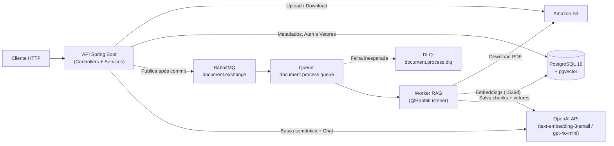

# AI Copilot — Assistente RAG para Documentos de Previdência

O **AI Copilot** é um backend em Java 21 e Spring Boot 3.5 que utiliza **RAG (*Retrieval-Augmented Generation*) orientado a eventos** para descomplicar regulamentos, contratos e apólices de previdência privada. Usuários autenticados enviam seus documentos em PDF, que são armazenados no Amazon S3, processados assincronamente via RabbitMQ e indexados no PostgreSQL com `pgvector`, permitindo fazer perguntas em linguagem natural com respostas fundamentadas exclusivamente nos trechos do documento e acompanhadas das páginas de origem.

---

## Arquitetura



- **Fluxo de ingestão (assíncrono):** `POST /api/v1/documents` valida o PDF (`%PDF-`), envia ao S3 fora de transação, grava o registro `PENDING` no PostgreSQL, publica o evento no RabbitMQ após o commit (`AFTER_COMMIT`), e o worker extrai as páginas, divide em chunks, gera embeddings na OpenAI e indexa no `pgvector` marcando o documento como `COMPLETED`.
- **Fluxo de chat (síncrono com RAG):** `POST /api/v1/chat` verifica posse e status `COMPLETED` do documento, executa busca por similaridade no `pgvector` filtrada por `document_id` e `owner_id` via `QuestionAnswerAdvisor`, injeta os trechos relevantes no prompt e retorna a resposta do modelo (`gpt-4o-mini`) junto às referências de página e trecho (`sources`).

---

## Stack Tecnológica

| Tecnologia | Versão | Por que foi escolhida |
|---|---|---|
| **Java (Temurin)** | 21 LTS | Records imutáveis, *pattern matching* e desempenho moderno na JVM. |
| **Spring Boot** | 3.5.15 | Ecossistema maduro com injeção de dependência, validação, segurança, transações e suporte nativo à RFC 7807 (`ProblemDetail`). |
| **Spring Security (OAuth2 Resource Server)** | 6.x | Emissão e validação nativa de JWT (HS256) com `NimbusJwtEncoder`/`NimbusJwtDecoder`, sem filtros manuais. |
| **Spring AI** | 1.1.8 | Abstração unificada para `ChatClient`, `QuestionAnswerAdvisor`, `PagePdfDocumentReader`, `TokenTextSplitter` e `PgVectorStore`. |
| **PostgreSQL + pgvector + Flyway** | 16 | Banco relacional e vetorial na mesma infraestrutura (índice HNSW para cosseno e GIN para metadados JSONB), versionado por migrations SQL. |
| **RabbitMQ (Spring AMQP)** | 4.x | Processamento assíncrono resiliente de PDFs com controle de `prefetch`, confirmação automática e roteamento nativo para Dead-Letter Queue (DLQ). |
| **AWS SDK for Java v2 (S3)** | 2.31.0 | Armazenamento escalável de objetos binários fora do banco de dados. |
| **JUnit 5 + Mockito + Testcontainers + Awaitility** | — | Testes unitários rápidos e testes de integração reais contra PostgreSQL/pgvector e RabbitMQ em containers Docker, com fakes determinísticos para S3 e OpenAI. |

---

## Decisões de Design

- **JWT nativo do Spring Security com refresh token opaco, rotação e detecção de reuso:** tokens de acesso curtos (15 min) combinados com refresh tokens de 256 bits persistidos via hash SHA-256, lock pessimista (`SELECT ... FOR UPDATE`) e revogação global das sessões do usuário caso um token revogado seja reutilizado ([detalhes em `docs/fase-2-user-auth.md`](docs/fase-2-user-auth.md#6-segurança-em-detalhe)).
- **Upload para o S3 fora de transação, com compensação:** evita reter conexões do pool JDBC durante I/O de rede e remove o objeto do S3 caso a gravação subsequente no banco falhe ([detalhes em `docs/fase-3-4-documentos-worker.md`](docs/fase-3-4-documentos-worker.md#5-transações-em-profundidade)).
- **Publicação na fila somente após o commit (`AFTER_COMMIT`):** elimina condições de corrida onde o worker consumiria a mensagem antes de a linha existir na tabela `document_registry` ([detalhes em `docs/fase-3-4-documentos-worker.md`](docs/fase-3-4-documentos-worker.md#53-transactionaleventlistenerphase--after_commit--por-que-publicar-na-fila-antes-do-commit-causa-bugs-graves)).
- **Idempotência no worker RAG:** mensagens duplicadas para documentos já `COMPLETED` são ignoradas, e reprocessamentos limpam previamente os vetores antigos por `document_id` antes de inserir novos chunks ([detalhes em `docs/fase-3-4-documentos-worker.md`](docs/fase-3-4-documentos-worker.md#64-semântica-at-least-once-idempotência-e-onde-fica-o-retry)).
- **Dead-Letter Queue (DLQ) vs. erro permanente:** PDFs sem texto extraível (ex.: imagens sem OCR) são marcados como `FAILED` com confirmação (`ack`) imediata, enquanto falhas inesperadas encaminham a mensagem para `document.process.dlq` ([detalhes em `docs/fase-3-4-documentos-worker.md`](docs/fase-3-4-documentos-worker.md#61-exchange-fila-binding-routing-key-dlx-e-dlq)).
- **Retry nos clientes HTTP:** retentativas com *exponential backoff* ficam configuradas no cliente da OpenAI (`spring.ai.retry`) e no AWS SDK, evitando repetir o download e o parse do PDF inteiro em oscilações momentâneas de rede ([detalhes em `docs/fase-3-4-documentos-worker.md`](docs/fase-3-4-documentos-worker.md#64-semântica-at-least-once-idempotência-e-onde-fica-o-retry)).
- **Posse verificada no banco e no filtro vetorial (defesa em profundidade):** o chat valida a posse do documento no PostgreSQL (retornando 404 para outros usuários) e aplica filtro duplo `document_id == '...' && owner_id == '...'` na busca semântica do `pgvector` ([detalhes em `docs/fase-5-chat-rag.md`](docs/fase-5-chat-rag.md#8-segurança)).
- **Prompts externos configuráveis com validação *fail fast* no boot:** os templates de sistema e de RAG são validados na subida da aplicação (`ChatPromptsLoader`), impedindo que prompts em branco ou com marcadores quebrados cheguem em produção ([detalhes em `docs/fase-5-chat-rag.md`](docs/fase-5-chat-rag.md#6-prompt-configurável)).

---

## Como Rodar

### Pré-requisitos
- **Java 21** (Temurin recomendado)
- **Docker Desktop** em execução
- **Conta AWS** com um bucket S3 criado e AWS CLI instalada
- **Chave de API da OpenAI** (`OPENAI_API_KEY`)

### Passo a passo
1. **Suba o PostgreSQL (`pgvector`) e o RabbitMQ:**
   ```powershell
   docker compose up -d
   ```
2. **Configure o arquivo `.env` na raiz do projeto** (copiando de `.env.example`):
   ```properties
   OPENAI_API_KEY=sk-...
   JWT_SECRET=sua-chave-secreta-com-no-minimo-32-caracteres
   S3_BUCKET=nome-do-seu-bucket-s3
   AWS_REGION=us-east-1
   ```
3. **Configure suas credenciais da AWS no perfil local (`~/.aws/credentials`):**
   ```powershell
   aws configure
   ```
4. **Inicie a aplicação:**
   ```powershell
   .\mvnw.cmd spring-boot:run
   ```

---

## Endpoints da API

| Método | Rota | Autenticação | Descrição |
|---|---|---|---|
| `POST` | `/api/v1/users` | Pública | Cadastra um novo usuário (`201 Created`). |
| `GET` | `/api/v1/users/me` | `Bearer JWT` | Retorna os dados do usuário autenticado (`200 OK`). |
| `POST` | `/api/v1/auth/login` | Pública | Autentica por e-mail/senha e emite `accessToken` + `refreshToken` (`200 OK`). |
| `POST` | `/api/v1/auth/refresh` | Pública | Rotaciona o `refreshToken` e emite novo par de tokens (`200 OK`). |
| `POST` | `/api/v1/auth/logout` | Pública | Revoga o `refreshToken` informado (`204 No Content`). |
| `POST` | `/api/v1/documents` | `Bearer JWT` | Faz upload multipart de um PDF e inicia o processamento assíncrono (`202 Accepted`). |
| `GET` | `/api/v1/documents/{id}` | `Bearer JWT` | Consulta o status (`PENDING`, `PROCESSING`, `COMPLETED`, `FAILED`) e quantidade de chunks de um documento (`200 OK`). |
| `GET` | `/api/v1/documents` | `Bearer JWT` | Lista os documentos do usuário autenticado ordenados do mais recente ao mais antigo (`200 OK`). |
| `POST` | `/api/v1/chat` | `Bearer JWT` | Faz uma pergunta sobre um documento `COMPLETED` e retorna a resposta fundamentada + fontes (`200 OK`). |

---

## Roteiro de Demonstração (`requests.http`)

O arquivo [`requests.http`](requests.http) na raiz do projeto contém todas as chamadas prontas para o HTTP Client do IntelliJ IDEA (ou extensão REST Client do VS Code), encadeando variáveis automaticamente:

1. Coloque um PDF com texto selecionável em `samples/regulamento.pdf` (veja [`samples/README.md`](samples/README.md)).
2. Execute a requisição **1. Cadastro** (`POST /api/v1/users`).
3. Execute a requisição **4. Login** (`POST /api/v1/auth/login`) — o script salva `accessToken` e `refreshToken` automaticamente.
4. Execute a requisição **11. Upload de documento** (`POST /api/v1/documents`) — o script salva `documentId`.
5. Execute a requisição **12. Consultar status** (`GET /api/v1/documents/{{documentId}}`) até o campo `status` mudar para `COMPLETED`.
6. Execute a requisição **14. Chat sobre o documento** (`POST /api/v1/chat`) para obter a explicação baseada no PDF e a lista de `sources`, e a requisição **15** para validar que perguntas fora do escopo do documento são recusadas sem alucinação.

---

## Personalização do Prompt

Os prompts ficam desacoplados do código Java e podem ser substituídos sem recompilar a aplicação:
- Padrão embutido: `classpath:prompts/system-prompt.st` e `classpath:prompts/rag-prompt.st`.
- Exemplo customizado (tom técnico voltado a corretores): [`prompts/system-prompt.custom.st`](prompts/system-prompt.custom.st).

Para ativar o prompt customizado, defina a variável de ambiente:
```properties
APP_CHAT_SYSTEM_PROMPT=file:./prompts/system-prompt.custom.st
```
ou inicie com `--app.chat.system-prompt=file:./prompts/system-prompt.custom.st`.
- **Regras:** o system prompt não pode conter `{` ou `}`; o template de RAG deve conter obrigatoriamente `{query}` e `{question_answer_context}`. Como os prompts são lidos e validados na inicialização, reinicie a aplicação após alterá-los (veja [`prompts/README.md`](prompts/README.md)).

---

## Testes Automatizados

Com o Docker Desktop aberto, execute:

```powershell
.\mvnw.cmd verify
```

A suíte executa **testes unitários** (JUnit 5 + Mockito) e **testes de integração de ponta a ponta** (`@IntegrationTest` com MockMvc, Testcontainers para PostgreSQL/`pgvector` e RabbitMQ, e Awaitility). Chamadas externas para S3 e OpenAI são substituídas por fakes determinísticos em memória (`InMemoryStorageService`, `FakeEmbeddingModel` e `FakeChatModel`), garantindo execução rápida, reproduzível e sem custo de API.

---

## Próximos Passos (Roadmap de Produção)

- **Streaming de respostas via Server-Sent Events (SSE):** uso de `chatClient.prompt()...stream()` retornando `Flux<String>`.
- **Memória de conversa multi-turno:** integração com `MessageChatMemoryAdvisor` persistido por sessão.
- **Citação explícita de página no corpo da resposta:** enriquecimento do texto formatado de cada chunk com o número da página antes do envio ao LLM.
- **Busca híbrida (BM25 + Vetores) e Re-ranking:** combinação de *Full-Text Search* do PostgreSQL (`tsvector`) com similaridade de cosseno e modelo de *cross-encoder re-ranker*.
- **Avaliação automatizada de RAG (*RAG Evaluation*):** métricas de *faithfulness* e *answer relevance* usando conjunto de perguntas de referência.
- **Transactional Outbox Pattern:** persistência de eventos em tabela `outbox` na mesma transação do upload.
- **OCR para PDFs digitalizados:** fallback com AWS Textract ou Tesseract quando o PDF não possuir camada de texto.
- **Observabilidade completa:** métricas Micrometer/Prometheus e tracing distribuído (OpenTelemetry) entre HTTP, RabbitMQ e chamadas ao LLM.

---

## Documentação Didática Detalhada

Para uma explicação aprofundada de cada decisão arquitetural, paralelos com Node.js/NestJS, diagramas de sequência e perguntas de entrevista técnica:
- [Fase 2 — Usuários, Autenticação JWT, Refresh Token com Rotação e Segurança](docs/fase-2-user-auth.md)
- [Fases 3 e 4 — Upload de Documentos, Amazon S3, Mensageria RabbitMQ e Worker de Ingestão RAG](docs/fase-3-4-documentos-worker.md)
- [Fase 5 — Chat com RAG, Advisors do Spring AI, Prompts Configuráveis e Isolamento Multi-Tenant](docs/fase-5-chat-rag.md)
